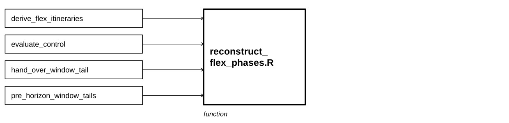

# reconstruct_flex_phases.R

**Function** &nbsp;·&nbsp; `30_Simulation/03_Functions/reconstruct_flex_phases.R`

## Function

Rebuilds the phase of every row of a flexibility window from the committed energy that Main_df already stores, without any label of its own. The phase codes are:

- 1 Commitment
- 2 Neutral
- 3 Recovery
- 0 outside the window

## Called by

- [derive_flex_itineraries.R](derive_flex_itineraries.md)
- [evaluate_control.R](evaluate_control.md)
- [hand_over_window_tail.R](hand_over_window_tail.md)
- [pre_horizon_window_tails.R](pre_horizon_window_tails.md)

## What it calls, in order of appearance

- Nothing: this piece calls no other piece of the project.

## Input data

- period_chunk : Data frame. Must carry time, MarketUTC and the committed-energy column of the leg being rebuilt.
- leg          : Character. "down" or "up".
- parameters   : Named list. parameters$control$neutral_phase_timespan and recovery_phase_timespan (h), commitment_phase_length_max (h), and parameters$computing$flex_energy_tol.

## Output data

- Integer vector, one entry per row of period_chunk: 1 inside a Commitment Phase, 2 inside a Neutral Phase, 3 inside a Recovery Phase, 0 outside any window.

## Other notes from the file header

### Why there is no label to read

Because storing one would be storing the same fact twice. The commitment is already written, row by row, in Elec_flex_down_plan and Elec_flex_up_plan, and a label beside it could only ever agree with it or contradict it. With a single source there is nothing to reconcile. The Commitment Phase is the support of that column - reward_function() defines the commitment as the energy difference multiplied by (phase == 1), so it is zero everywhere else by construction - and the other two phases follow from it: they are neutral_phase_timespan and recovery_phase_timespan hours long, both read from 08_Flexibility_Event_Configuration.csv.

### Why it works on market slots and not on rows

A Commitment Phase is assembled from whole market slots, so that is the grain the reconstruction has to use. Read row by row it would break on a case that is not rare at all: a row INSIDE the commitment whose committed energy is exactly zero, which happens whenever the flexible itinerary consumes the same as the plan at that instant - because the machine was already off, for example. Row by row that row would split one window into two and drop a Neutral Phase in the middle of a commitment. Slot by slot the slot stays in the phase as long as any of its rows carries something.

### Why a gap may be inside a window

A whole market slot inside a Commitment Phase may carry no commitment either: downward, when the plan consumes nothing in it, or less than the commitment margin, the flexible itinerary stays equal to the plan there. The committed slots of such a window form two stretches with a gap between them, and the gap belongs to the window. Two windows of the same leg that one market sees are never that close. evaluate_control() does not open a window whose Commitment, Neutral or Recovery Phase touches a row another window of the leg occupies, so the first row of the later window always comes more than neutral_phase_timespan + recovery_phase_timespan hours after the last row of the Commitment Phase of the earlier one. A window whose Commitment Phase ended before the chunk is not in the committed energy of the chunk at all, so it cannot be joined to a later one. The next committed stretch therefore joins the window when both:

- its first row falls within the Neutral or Recovery Phase that the window would lay after its last committed slot, that is, no more than neutral_phase_timespan + recovery_phase_timespan hours after the last row of that slot;
- the window, from its first slot to the last slot of that stretch, still fits within commitment_phase_length_max, with the same test that cuts a longer stretch (see below).

The slots of the gap are then part of the Commitment Phase, with no committed energy. A stretch that fails either test starts a window of its own. Slots with no commitment at the edges of a window are not part of it: the window simply starts at its first committed slot and ends at its last one.

### Code outline

1. Which market slots carry a commitment
2. Join the committed stretches that belong to one window
3. Lay the three phases on each window

### Usage instructions

```r
phase <- reconstruct_flex_phases(period_chunk, "up", parameters)
```

### Exceptions and special cases

- A stretch of committed slots longer than commitment_phase_length_max cannot be one Commitment Phase, so it is cut into consecutive windows of at most that length. It should not arise once windows are written whole, and cutting it is the honest reading if it does. Such a stretch is never joined to the stretch before or after it, because the joined window could not fit either.
- The two legs are rebuilt independently and may overlap each other. That is intended: they are two different itineraries living in two different sets of columns.
- A window whose Neutral or Recovery Phase runs past the end of the chunk simply has it truncated. What is outside the chunk is not this chunk's business.

## Diagram



Also available as [reconstruct_flex_phases.svg](reconstruct_flex_phases.svg).

---

[Back to the code structure index](../Code_Structure.md)
