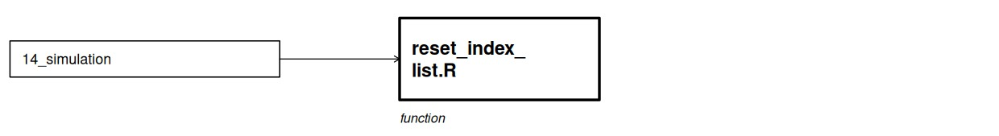

# reset_index_list.R

**Function** &nbsp;·&nbsp; `30_Simulation/03_Functions/reset_index_list.R`

## Function

Returns a zeroed index list, matching the fields of simulation_control$indexes_global / simulation_control$indexes_local that must be reset after each market process (Scheduling, Piloting, Execution) in the main simulation loop.

## Called by

- [14_simulation.R](14_simulation.md)

## What it calls, in order of appearance

- Nothing: this piece calls no other piece of the project.

## Input data

- (none)

## Output data

- Named list with these elements, all set to 0:
    - i0
    - i_begin_horizon
    - i_end_horizon
    - i_end_control
    - idx_period
    - idx_horizon
    - idx_ctrl
    - i_flex

## Other notes from the file header

### Code outline

1. Build and return the zeroed index list

### Usage instructions

simulation_control$indexes_global[names(reset_index_list())] <- reset_index_list() simulation_control$indexes_local[names(reset_index_list())]  <- reset_index_list()

### Exceptions and special cases

- indexes_global and indexes_local also hold an n_steps field that must persist across the whole simulation loop. The partial, named-subset assignment shown above updates only the 8 fields returned by this function, leaving n_steps (and any other field not covered here) untouched. A full-list replacement (simulation_control$indexes_global <- reset_index_list()) would instead wipe out n_steps and must not be used.

## Diagram

Also available as [reset_index_list.svg](reset_index_list.svg).

---

[Back to the code structure index](../Code_Structure.md)
