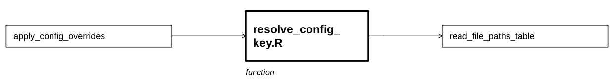

# resolve_config_key.R

**Function** &nbsp;·&nbsp; `30_Simulation/03_Functions/resolve_config_key.R`

## Function

Gives the file name of a configuration file named by its key in 00_Inner_parameters/04_File_paths.csv. A file common to the whole simulation (scope "system") is named by its key, for example "reward_file". A file that every asset of a type of model holds is named by the asset and the key, <asset_id>/<key>, for example "Building_001/model_file". The type of the asset is the part of its identifier before the underscore and the number of three digits, and it has to be the scope of the key.

## Called by

- [apply_config_overrides.R](apply_config_overrides.md)

## What it calls, in order of appearance

- [read_file_paths_table.R](read_file_paths_table.md)

## Input data

- key_name    : Character of length one. A key of the file paths table, or <asset_id>/<key> for a file of an asset. It carries no leading @.
- config_path : Character. Path of the configuration folder.

## Output data

- Character of length one: the file name, relative to the configuration folder. For a file of an asset it is the folder of the assets (the file of the key asset_config_folder), the identifier of the asset and the file name of the key. The run stops if the key is not in the table, if a system key carries an asset, if a key of a type of model has no asset, or if the type of the asset is not the scope of the key.

## Other notes from the file header

### Code outline

1. Read the table of file names
2. Split the asset from the key
3. Look up the key and build the file name

### Usage instructions

```r
resolve_config_key("reward_file", config_path)
```

```r
resolve_config_key("Building_001/model_file", config_path)
```

## Diagram



Also available as [resolve_config_key.svg](resolve_config_key.svg).

---

[Back to the code structure index](../Code_Structure.md)
