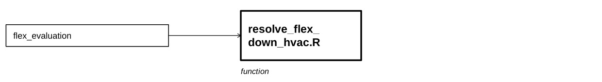

# resolve_flex_down_hvac.R

**Function** &nbsp;·&nbsp; `30_Simulation/05_Models/01_Building/03_Functions/resolve_flex_down_hvac.R`

## Function

Decides which of the two HVAC systems, heating or cooling, provides a downward flexibility window, so that the other one can be locked during the Recovery Phase (see build_hvac_lock_caps()).

## Called by

- [flex_evaluation.R](flex_evaluation.md)

## What it calls, in order of appearance

- Nothing: this piece calls no other piece of the project.

## Input data

- period_chunk_subset : Data frame. The rows of the window, with the columns Q_heat_plan and Q_cool_plan (kWh per timestep) and Flex_phase_down_plan, the phase code of every row (1 Commitment, 2 Neutral, 3 Recovery).

## Output data

- Character scalar, one of: "heat" - heating accumulates at least as much heat as cooling. "cool" - cooling accumulates more heat. "none" - neither system runs during the Commitment Phase.

## Other notes from the file header

### Why the system is read and not chosen

A downward window switches off whatever is running, so, unlike an upward window (see resolve_flex_up_hvac()), it does not need a system to be chosen before it is drawn. The system that provides it is simply the one that was running. The simulation keeps heating and cooling mutually exclusive at every timestep, but not over a whole window, and a long Commitment Phase can contain a change of system halfway through. The system with the larger planned heat over the Commitment Phase is then the one taken:

S_heat = sum of Q_heat_plan over the rows of phase 1 S_cool = sum of Q_cool_plan over the same rows

When both are zero, nothing was flexed and no system is locked.

### Code outline

1. Accumulate the planned heat of each system over the Commitment Phase
2. Take the larger one

### Usage instructions

```r
hvac_used <- resolve_flex_down_hvac(period_chunk_subset)
```

## Diagram



Also available as [resolve_flex_down_hvac.svg](resolve_flex_down_hvac.svg).

---

[Back to the code structure index](../Code_Structure.md)
