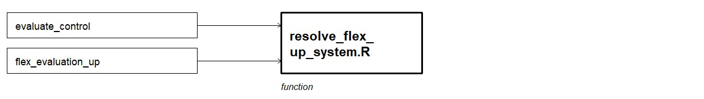

# resolve_flex_up_system.R

**Function** &nbsp;·&nbsp; `30_Simulation/03_Functions/resolve_flex_up_system.R`

## Function

Decides which of the two HVAC systems, heating or cooling, may be used to offer upward flexibility from a given start row.

## Called by

- [evaluate_control.R](evaluate_control.md)
- [flex_evaluation_up.R](flex_evaluation_up.md)

## What it calls, in order of appearance

- Nothing: this piece calls no other piece of the project.

## Input data

- period_chunk : Data frame. Planning-period data. Must contain the columns time (POSIXct), Elec_heat_plan and Elec_cool_plan (Numeric, kWh per timestep, as produced by period_calculation() with calculation_context = "plan").
- i_flex       : Integer scalar. Row of period_chunk at which the candidate upward flexibility event would start.
- parameters   : Named list. Must contain: parameters$control$flex_up_horizon_long  : Numeric (h). parameters$control$flex_up_horizon_short : Numeric (h). parameters$control$flex_up_dominance_threshold : Numeric (%), 0 to 100.

## Output data

- Character scalar, one of: "heat" - heating dominates both horizons; upward flexibility may be offered by running the heating system harder. "cool" - cooling dominates both horizons. "none" - no clear system; no upward flexibility can be committed from this start row.

## Other notes from the file header

### Why a system has to be fixed at all

Downward flexibility is symmetric between the two systems: whatever is running gets switched off. Upward flexibility is not, because it means running a system harder, and running the wrong one would heat a building that needs cooling. On top of that, the regulation of HVAC systems does not allow energy management through the alternating use of heating and cooling, so the building has to commit to one system and stay with it - see build_system_lock_caps() for the restriction that enforces this during the Recovery Phase. The system is therefore fixed in advance, and only when the situation is unambiguous. If it is not, no upward flexibility can be committed at that start row.

### The dominance criterion

The planned electricity of each system is accumulated over two horizons, one medium-term and one short-term. Electricity, and not heat, is the quantity the market trades and the one the technical feasibility rule (flex_window_is_feasible()) measures, so both rules judge the two systems on the same footing:

```r
S_heat(H) = sum of Elec_heat_plan over the rows in [t0, t0 + H)
```

S_cool(H) = sum of Elec_cool_plan over the same rows

The dominance index is measured over the LARGER of the two, in absolute value:

```r
D(H) = | S_heat(H) - S_cool(H) | / max( |S_heat(H)| , |S_cool(H)| )
```

It is bounded in [0, 1]: it is 1 when one of the systems is not used at all, and 0 when both are used equally. It is undefined only when neither system is used, which is treated as "no dominant system".

A system dominates a horizon when D(H) exceeds the threshold, and the system is fixed only when both horizons agree:

s* = dominant(H_long)  if dominant(H_long) == dominant(H_short)

- and neither is "none"

s* = "none"            otherwise

Requiring both horizons to agree is what filters out the shoulder seasons, where the building alternates between heating and cooling within the same day and committing to either would be wrong.

### Code outline

1. Validate inputs
2. Accumulate the planned electricity of each system over the two horizons
3. Resolve the dominant system of each horizon
4. Fix the system only if both horizons agree

### Usage instructions

```r
system_up <- resolve_flex_up_system(period_chunk, i_flex, parameters)
```

### Exceptions and special cases

- The horizon window is half-open, [t0, t0 + H). This is deliberately different from the Commitment Phase of flex_evaluation_down()/flex_evaluation_up(), which is closed, [t0, t0 + L]. The Commitment Phase window is closed because it reproduces the definition of the event that the code already had, and moving that boundary would move what is committed. This window is new and sums "the next H hours", for which the half-open form is the natural one: it does not count the boundary row twice if windows are ever chained. Both are correct as written and must not be unified.
- A window truncated by the end of period_chunk is evaluated over the rows that are actually available, down to a single row: the window is [t0, t0 + H) and always contains the start row itself, so it is never empty and this function always returns a verdict. A verdict based on one row is not meaningful on its own, but it is harmless, because the candidate is rejected downstream anyway: flex_evaluation_up() returns period_chunk untouched when there is not enough room for the full Commitment plus Neutral plus Recovery Phase. Keeping the guard in one place, where the window length is actually known, avoids two different definitions of "too close to the end".
- If both systems accumulate zero heat over a horizon, that horizon has no dominant system and the result is "none".
- An exact tie between the two systems also yields "none", because D(H) is then 0 and cannot exceed a threshold that is itself >= 0. A threshold of 0 would still reject a tie, which is the intended behaviour.

## Diagram



Also available as [resolve_flex_up_system.svg](resolve_flex_up_system.svg).

---

[Back to the code structure index](../Code_Structure.md)
