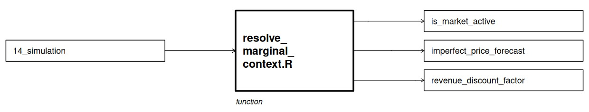

# resolve_marginal_context.R

**Function** &nbsp;·&nbsp; `30_Simulation/03_Functions/resolve_marginal_context.R`

## Function

Computes the baseline commitment (E_orig) and current-market prices needed to value a candidate control schedule at its marginal (differential) cost, per target market interval of the horizon about to be optimized. This is called once per market process (Scheduling or Piloting), before the GA runs, so that every candidate evaluated by the fitness function is priced against the same fixed baseline and prices. Both the base-energy track and the explicit-flexibility track are always resolved: reward_function() selects which of them it needs based on parameters$control$optimization_aim ("energy" only needs the base track; "flexibility"/"operationflex" also need the explicit-flexibility track), not on whether the market is Scheduling or Piloting - unlike integrate_market_process(), which only ever commits the explicit-flexibility track economically for Piloting, reward_function() has no such prefix-based distinction: a Scheduling market configured with a "flexibility" aim explores flexibility exactly the same way Piloting does. Reuses exactly the same row/column resolution as integrate_market_process.R (row_m_full on the full market-resolution grid for column offsets; row_m, the sparse row of the current event in full_market_information's own row set, for price lookups) and the same per-interval SUM aggregation of Main_df's existing *_plan columns, so that the baseline priced here is guaranteed to match what integrate_market_process() will later treat as E_orig for the same market event.

## Called by

- [14_simulation.R](14_simulation.md)

## What it calls, in order of appearance

- [is_market_active.R](is_market_active.md)
- [imperfect_price_forecast.R](imperfect_price_forecast.md)
- [revenue_discount_factor.R](revenue_discount_factor.md)

## Input data

- row_index               : Integer. Current simulation row index (CONT_003).
- Main_df                 : Data frame. The main simulation data frame, in its state before this market's optimization overwrites any *_plan columns.
- simulation_control      : Named list. Must contain indexes_global$idx_horizon, the current market's optimization horizon, which is what gets valued, and indexes_global$idx_ctrl, its control horizon, which is where the published prices stop.
- market_time             : POSIXct vector. Sorted unique MarketUTC intervals on the full market-resolution grid; used only to compute future-step column offsets (col_j).
- full_market_information : Named list of 13 market-event price data frames (read-only), as built by 11_full_market_information_setup.R.
- parameters              : Named list. Only parameters$forecast is read, for the price forecast: price_forecast_type, and when it is "inaccurate", price_forecast_n_days_back and price_forecast_weight_history.

## Output data

- Named list with: market_utc               : POSIXct vector. MarketUTC of each target interval, in the same order as every other element below. E_orig_base_by_market    : Numeric vector. Main_df$Elec_total_plan summed per target interval, before this market's optimization. E_orig_expflex_down_by_market : Numeric vector. Main_df$Elec_flex_down_plan summed per target interval, before this market's optimization. E_orig_expflex_up_by_market : Numeric vector. Main_df$Elec_flex_up_plan summed per target interval, before this market's optimization. One baseline per leg: both signals are non-negative by construction, so they cannot be told apart by sign once added together. P_import_buy_by_market, P_import_sell_by_market, P_export_buy_by_market, P_export_sell_by_market : Numeric vectors. Current-market energy prices per target interval, ready to pass straight into calc_differential_cost()/ compute_marginal_energy_cost() for the base-energy and flex-adjusted-energy terms. distribution_rate_by_market : Numeric vector. Current-market Elec_unit_cost_distribution rate per target interval, ready to pass into compute_marginal_distribution_cost() for the base-energy term only (not used for flexibility). p_up_buy_by_market, p_up_sell_by_market, p_down_buy_by_market, p_down_sell_by_market : Numeric vectors. Effective up/down flexibility prices per target interval (commitment + execution * probability), ready to pass into the same functions for the explicit-flexibility term. p_down_com_buy_by_market, p_down_com_sell_by_market, p_up_com_buy_by_market, p_up_com_sell_by_market, p_down_exec_buy_by_market, p_down_exec_sell_by_market, p_up_exec_buy_by_market, p_up_exec_sell_by_market : Numeric vectors. The two halves of those effective prices, unbundled: the commitment price, which is paid for certain, and the execution price, which is only paid if the operator calls the service. flex_probab_down_by_market, flex_probab_up_by_market : Numeric vectors in [0, 1]. Activation probability of each leg per target interval. Together with the two price families above they let the caller value the certain and the conditional halves of the service separately, which the bundled effective price cannot express: the execution of a commitment also moves the building's energy during the Recovery Phase, and that cost is conditional on the same probability. revenue_discount_by_market : Numeric vector. Revenue discount factor of each target interval, as returned by revenue_discount_factor(). It weighs down income that is far from the decision instant, and only income. revenue_discount_per_hour  : Numeric scalar (%). The rate those factors were built from, carried so that the caller can build the same factors for instants outside the target set. discount_origin_time       : POSIXct scalar. The decision instant H the factors are counted from, this market event's own market interval.

## Other notes from the file header

### What is valued and what is committed

These are two different sets of market intervals, and keeping them apart is the whole point of this function's shape. The intervals returned here are those of the OPTIMIZATION HORIZON, because the optimizer decides the setpoints of that whole horizon and every energy flow and unit cost of it has to reach the reward. Their prices are the published ones inside the control horizon and a forecast beyond it. The intervals that are COMMITTED are only those of the control horizon, and they are built inside integrate_market_process() from idx_ctrl, not here. The stretch valued with forecast prices therefore never reaches the settlement: the next market finds those hours with nothing booked on them and values them again with prices it does know, which is what keeps the double counting away with no artifice.

### Code outline

1. Market row (full grid and sparse) and target market intervals
2. Baseline commitments before this market (SUM aggregation)
3. Current-market prices per target interval
4. Price forecast beyond the control horizon
5. Revenue discount factors of the horizon

### Usage instructions

```r
marginal_context <- resolve_marginal_context(row_index, Main_df, simulation_control, market_time, full_market_information)
```

## Diagram



Also available as [resolve_marginal_context.svg](resolve_marginal_context.svg).

---

[Back to the code structure index](../Code_Structure.md)
