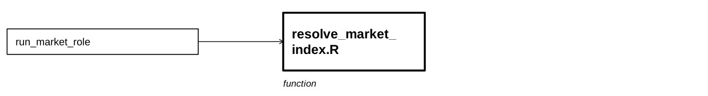

# resolve_market_index.R

**Function** &nbsp;·&nbsp; `30_Simulation/03_Functions/resolve_market_index.R`

## Function

Converts a market timestamp to its index position in a reference time vector.

## Called by

- [run_market_role.R](run_market_role.md)

## What it calls, in order of appearance

- Nothing: this piece calls no other piece of the project.

## Input data

- time_raw    : Scalar value with the timestamp to locate.
- column_name : Character. Source column name for error messages.
- row_index   : Integer. Current simulation row for error messages.
- time_vector : POSIXct vector where the timestamp must exist.

## Output data

- Integer index position in time_vector.

## Other notes from the file header

### Usage instructions

```r
resolve_market_index(time_raw, column_name, row_index, time_vector)
```

### Code outline

1. Parse the timestamp, stopping if it is not readable.
2. Locate it in the time vector, stopping if it is not there.

## Diagram



Also available as [resolve_market_index.svg](resolve_market_index.svg).

---

[Back to the code structure index](../Code_Structure.md)
