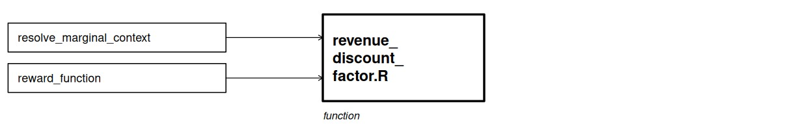

# revenue_discount_factor.R

**Function** &nbsp;·&nbsp; `30_Simulation/03_Functions/revenue_discount_factor.R`

## Function

Builds the geometric discount factor that the reward applies to income that is far away in time, one factor per instant.

## Called by

- [resolve_marginal_context.R](resolve_marginal_context.md)
- [reward_function.R](reward_function.md)

## What it calls, in order of appearance

- Nothing: this piece calls no other piece of the project.

## Input data

- target_time           : POSIXct vector. Instants whose income is being discounted, normally the market intervals of the optimization horizon.
- origin_time           : POSIXct scalar. Decision instant H, the market interval at which this optimization runs. n is counted from here.
- discount_per_hour     : Numeric scalar (%). Revenue_discount_per_hour, between 0 and 100. 0.25 means 0.25 % per hour.

## Output data

- Numeric vector, same length as target_time. The factor (1 - discount_per_hour/100)^n of each instant, where n is the number of hours from origin_time to that instant.

## Other notes from the file header

### Why this factor exists

A decision has to be prudent about what it expects to earn far into the future, the same way an economic appraisal discounts future revenue. Without it, an income of one euro ten hours ahead weighs exactly as much in the decision as one euro in the next slot, and the optimizer has no reason to prefer the operation that pays sooner. Revenue_discount_per_hour is the hourly rate of that prudence: with A = 0.25 (%), an income n hours ahead is worth (1 - 0.0025)^n of its face value at the decision instant.

### Decision only, never accounting

The factor belongs to the decision process alone. It never reaches the volume or the price of an energy or flexibility commitment: integrate_market_process() settles what was decided at the market's own undiscounted prices, so the discount changes which candidate wins the optimization, not what the winner is then paid for.

### Code outline

1. Hours from the decision instant to each target instant
2. Geometric factor

### Usage instructions

```r
f <- revenue_discount_factor(market_utc, Main_df$MarketUTC[row_index], parameters$reward$Revenue_discount_per_hour)
```

### Exceptions and special cases

- n is measured in exact hours, so it is fractional on a market grid finer than one hour: a 15-minute slot three hours and a quarter ahead gets n = 3.25, not 3. The assignment's example (H+3 -> n=3) is the whole-hour case of the same expression.
- n is bounded below at 0. An instant at or before the decision instant is not discounted: a factor above 1 would amplify income instead of being cautious about it, which is the opposite of what the parameter is for.
- A discount_per_hour of 0 yields a factor of exactly 1 everywhere, which is how the discount is switched off.

## Diagram



Also available as [revenue_discount_factor.svg](revenue_discount_factor.svg).

---

[Back to the code structure index](../Code_Structure.md)
