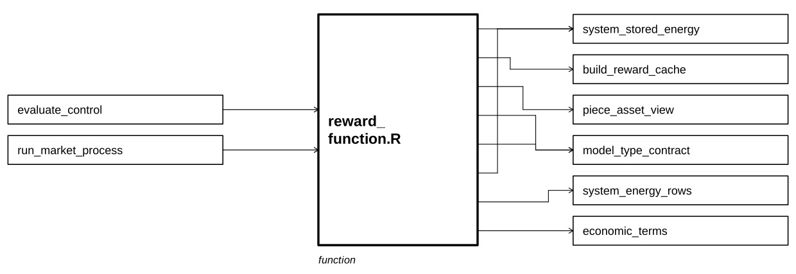

# reward_function.R

**Function** &nbsp;·&nbsp; `30_Simulation/03_Functions/reward_function.R`

## Function

This function calculates a reward function on the adequacy of a particular building HVAC operation over a planning period. It reads a piece of the market and values it with the same terms whatever the optimization_aim is:

- comfort, over the three itineraries;
- the marginal energy and distribution cost of the plan;
- the revenue of the flexibility of each leg, with the cost of its Recovery Phase;
- when an asset stores energy, the value of the energy the plan leaves stored, in the term of the energy of the plan (Elec_Cost_plan), and the value of the energy each leg leaves stored against the plan, in the term of the execution revenue (Elec_flex_exec_revenue_plan), both as the change against the committed itineraries;
- the technical feasibility penalty.

It brings together the two sides of the reward:

- the asset side, each asset of the asset registry, through the operations of its type of model (model_type_contract()):
    - comfort (comfort_term() for a Building) computes the comfort term of the asset from the comfort flags of the three itineraries, weighed with the comfort weight of the asset; the reward adds the terms of all the assets;
    - window_feasible (flex_window_is_feasible() for a Building) says whether the windows of each leg are a service the asset can render; the technical feasibility penalty counts one penalty per asset and leg that breaks the technical rules of its type, plus one when the windows already sold could not be drawn over the plan;
- the system side: economic_terms() computes every economic term from the rows of system_energy_rows() alone, that is the net electricity of the system in each itinerary per row and market interval, and the change of the energy the assets store, with the commitments and prices of marginal_context. It never sees a temperature, a mode or a setpoint.

Every economic term is differential: it values only the change against what earlier markets already committed. An itinerary identical to the committed one is valued 0, whatever the aim. marginal_context is mandatory: there is no fallback that values the full candidate commitment directly (ignoring the differential baseline), because such a fallback could silently mask a missing or broken marginal-cost chain upstream (e.g. a caller that forgot to call resolve_marginal_context()) instead of surfacing it as an error. Comfort is always evaluated over the full simulated energy flow of each itinerary, since the building's thermal evolution depends on the full energy applied.

## Called by

- [evaluate_control.R](evaluate_control.md)
- [run_market_process.R](run_market_process.md)

## What it calls, in order of appearance

- [system_stored_energy.R](system_stored_energy.md) &nbsp;(2 call sites)
- [build_reward_cache.R](build_reward_cache.md)
- [piece_asset_view.R](piece_asset_view.md)
- [model_type_contract.R](model_type_contract.md) &nbsp;(2 call sites)
- [system_energy_rows.R](system_energy_rows.md)
- [economic_terms.R](economic_terms.md)

## Input data

- piece                    : The piece of the planning period. The asset side (feasibility and comfort) works on the view of each asset, and the system side on the table of the system. They hold *_plan, *_plan_flex_down and *_plan_flex_up columns produced by period_calculation(), derive_flex_itineraries() and the flexibility evaluation functions. Columns read by comfort_term():
    - time
    - Comfort_plan
    - Comfort_plan_flex_down
    - Comfort_plan_flex_up

Columns read by system_energy_rows(), for the economic terms:

- MarketUTC
- Elec_total_plan
- Elec_total_plan_flex_down
- Elec_total_plan_flex_up
- Flex_phase_down_plan
- Flex_phase_up_plan
- the four row prices Elec_unit_cost_import/export_buy/sell
- Flex_Probab_down
- Flex_Probab_up

Columns read by the feasibility check:

- the columns flex_window_is_feasible() reads
- Standing_commitment_held_legs_plan, when the caller wrote it from derive_flex_itineraries()
- parameters               : Named list. Must contain: parameters$reward$alpha_cost : Numeric (1/EUR). Weight applied to every economic term. Mandatory: stop() is raised if absent. parameters$computing$flex_infeasible_penalty : Numeric. Weight of the technical feasibility term. Mandatory. parameters$assets : the asset registry, one entry per asset; its asset_type gives the type of model, and the comfort group of a building its comfort weight, alpha_comfort (1/h), read by comfort_term().
- optimization_aim       : Character. Aim of the market the reward is computed for: "energy", "operation", "flexibility", or "operationflex". Mandatory (no default).
- marginal_context          : Named list. Mandatory (no default). As returned by resolve_marginal_context(), with:
    - market_utc
    - E_orig_base_by_market
    - E_orig_gross_by_market
    - E_orig_expflex_down_by_market
    - E_orig_expflex_up_by_market
    - P_import_buy_by_market
    - P_import_sell_by_market
    - P_export_buy_by_market
    - P_export_sell_by_market
    - distribution_rate_by_market
    - p_down_com_buy_by_market
    - p_down_com_sell_by_market
    - p_up_com_buy_by_market
    - p_up_com_sell_by_market
    - p_down_exec_buy_by_market
    - p_down_exec_sell_by_market
    - p_up_exec_buy_by_market
    - p_up_exec_sell_by_market (the flex prices are per leg, "up"/"down", not "import"/"export" - see value_flex_operation())
    - flex_probab_down_by_market
    - flex_probab_up_by_market
    - revenue_discount_by_market
    - revenue_discount_per_hour
    - discount_origin_time
    - beyond_control_by_market
    - recovery_cost_committed_down
    - recovery_cost_committed_up (added by committed_recovery_cost())

stop()s if NULL, and also if it carries no revenue discount.

- reward_cache              : Named list or NULL (default NULL). As returned by build_reward_cache() for this piece's plan. The search for flexibility windows of evaluate_control() builds it once per leg, with the other leg fixed, and hands it to every candidate. With NULL it is built here, with no leg fixed.

## Output data

- piece        : The input piece, with a 'Reward' column added (or overwritten) in its table of the system, containing the per-row reward value for each timestep, plus the following intermediate result columns (all modes), as returned by economic_terms(), in the same table: Elec_Cost_plan              - Numeric. Electricity cost. The whole interval-aggregated marginal cost is concentrated on the last row (this column is not meaningful per-timestep; only its sum matters). Elec_Cost_distribution_plan - Numeric. Marginal distribution cost (base-energy term only), same last-row concentration as Elec_Cost_plan. And the columns of the flexibility terms: Elec_flex_down_plan        - Numeric. Energy difference (plan - plan_flex_down), bounded to the Commitment Phase: it is 0 wherever Flex_phase_down_plan is not 1. Elec_flex_up_plan          - Numeric. Energy difference (plan_flex_up - plan), bounded the same way to Flex_phase_up_plan == 1 and to 0 from below. Both signals are non-negative by construction. Elec_flex_com_revenue_plan  - Numeric. Certain revenue of the flexibility commitment, at the commitment price alone (same last-row concentration as Elec_Cost_plan). Elec_flex_exec_revenue_plan - Numeric. Expected revenue of the execution: the execution price weighted by the activation probability, plus the change of the cost of the energy the Recovery Phase would move if the service were called, against the committed itineraries. Same last-row concentration. And the column of the feasibility penalty: Technical_feasibility_penalty_plan - Numeric. The whole penalty, of all the assets and legs, on the last row. The caller is responsible for summing the Reward column when a scalar reward is required.

## Other notes from the file header

### The reward is dimensionless

The two weights are what make it so, and they are kept apart on purpose. alpha_comfort is in 1/h and multiplies the comfort term, which is measured in hours out of comfort; each building has its own, in its comfort group. alpha_cost is in 1/EUR and multiplies every economic term, which are in EUR; it is of the system, which values the energy of all its assets together. The reward is therefore a pure number, and what governs the optimizer's behaviour is the ratio between the two weights, not either of them on its own. Keeping the two weights apart also leaves room for more complex price structures: a new economic term only needs to be added inside economic_terms() to be weighted consistently with the rest.

### Sign convention

Every term already carries its own sign: comfort is 0 in comfort and negative out of it, every economic term is positive for an income and negative for an expense, and the feasibility penalty is 0 or negative. Reward is therefore a pure sum of the comfort term, the weighted economic term and the feasibility penalty, never a mix of "+" and "-" that has to be remembered per term.

### Code outline

1. Extract the alpha_cost parameter
2. Terms that depend on the plan only: revenue discount, target interval of each row, and marginal energy and distribution cost (build_reward_cache())
3. Technical feasibility of the flexibility itineraries, per asset and leg
4. Comfort term (the operation comfort of the model of each asset)
5. Economic terms (system_energy_rows() and economic_terms())
6. Store the terms and the per-row reward in the data frame

### Usage instructions

```r
piece <- reward_function(piece, parameters, optimization_aim,
  marginal_context)
```

```r
piece <- reward_function(piece, parameters, optimization_aim,
  marginal_context, reward_cache)
```

### Exceptions and special cases

- If marginal_context is NULL, stop() is called immediately (see header).
- If parameters$reward$alpha_cost is NULL, stop() is called immediately (no default value is used). comfort_term() does the same with the alpha_comfort of a building.
- If marginal_context carries no revenue discount, stop() is called immediately. Treating its absence as "no discount" would silently turn a broken context into a valid-looking optimization run at a different, undeclared prudence.
- If optimization_aim is none of "energy", "operation", "flexibility" or "operationflex", stop() is called.
- Whatever the aim, the comfort penalty applies to every time step where ANY of Comfort_plan, Comfort_plan_flex_down or Comfort_plan_flex_up is 0 (out of its own band), occupied or not.
- Only the Commitment Phase carries a commitment: Elec_flex_down_plan and Elec_flex_up_plan are 0 outside it, and each market interval is valued at its own flexibility prices. The Neutral and Recovery Phases are a consequence of the event, not a service sold, so they enter the reward only through the change of the Recovery Phase cost.

## Diagram



Also available as [reward_function.svg](reward_function.svg).

---

[Back to the code structure index](../Code_Structure.md)
