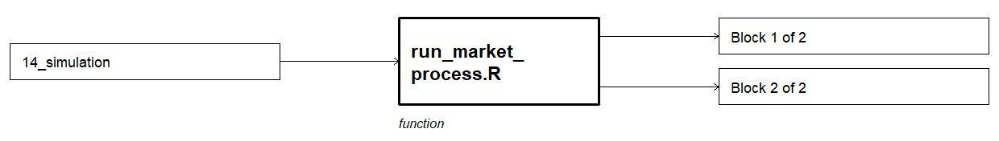

# run_market_process.R

**Function** &nbsp;·&nbsp; `30_Simulation/03_Functions/run_market_process.R`

## Function

Executes one market optimization process (Scheduling or Piloting) over a sliced simulation period. Between i0 and i_begin_horizon the plan is simulated as it stands, with the forecast of this market, and both flexibility itineraries are projected over it: the windows committed from i0 onwards are drawn as the new plan allows, without judging them and without changing any commitment. When a window whose Commitment Phase starts there runs into the optimization horizon, that period is extended to the end of its Recovery Phase, and what the optimization needs to continue the tail is handed over in simulation_control$flexibility$pre_horizon_tail: the optimization continues it over the plan of each candidate and starts no window of the same leg on it. Whatever the aim, the optimization keeps the commitments of the market interval inside the commitment margin: the part the new plan no longer holds is given back (see derive_flex_itineraries()). That is the only flexibility a market with the "operation" aim trades.

## Called by

- [14_simulation.R](14_simulation.md)

## What it calls, in order of appearance

- [map_optimization_aim.R](map_optimization_aim.md)
- [pre_horizon_window_tails.R](pre_horizon_window_tails.md)
- [implement_control_step.R](implement_control_step.md)
- [derive_flex_itineraries.R](derive_flex_itineraries.md) &nbsp;(2 call sites)
- [hand_over_window_tail.R](hand_over_window_tail.md)
- [optimize_control_step.R](optimize_control_step.md) &nbsp;(2 call sites)
- [period_calculation.R](period_calculation.md)
- [reward_function.R](reward_function.md)
- [evaluate_control.R](evaluate_control.md)

## Blocks

The piece calls 9 items, so it is documented in blocks:

- [Called items, block 1 of 2](run_market_process__1.md)
- [Called items, block 2 of 2](run_market_process__2.md)

## Input data

- prefix             : Character. "Sched" or "Pilot".
- row_index          : Integer. Current simulation row index.
- period_chunk       : Data frame. Sliced Main_df period to process.
- market_parameters  : List. Market fields for the current row.
- simulation_control : List. Control metadata (indexes, evaluation, flexibility, calculation_mode).
- timestamps         : List. Timestamp metadata for period_chunk.
- parameters         : List. Simulation parameters.
- marginal_context   : Named list or NULL (default NULL). As returned by resolve_marginal_context(), computed by 14_simulation.R from Main_df before this market's optimization. Passed through to optimize_control_step() (for "energy"/ "flexibility" aims) and evaluate_control() (for "operationflex"); unused for "operation".
- Callers must guard the call with is_market_active() on the relevant *_Market_Name field; this function assumes the market is active and does not re-check it.

## Output data

- Data frame. The updated period_chunk with plan/plan_flex_down columns injected over the implementation horizon.

## Other notes from the file header

### Usage instructions

```r
run_market_process(prefix, row_index, period_chunk, ...)
```

### Code outline

1. Translate the market's aim into its internal name.
2. Initialization period: simulate the plan from i0, project the windows that start there and hand their tail over.
3. Optimize, or fly the plan straight when the aim is operation.
4. Inject the result over the control horizon.

## Diagram



Also available as [run_market_process.svg](run_market_process.svg).

---

[Back to the code structure index](../Code_Structure.md)
