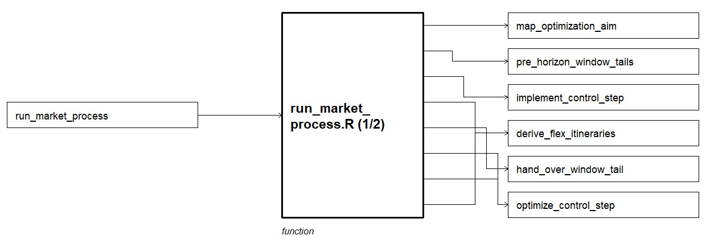

# run_market_process.R &mdash; Called items, block 1 of 2

Block 1 of 2 of [run_market_process.R](run_market_process.md).

## What it calls, in this block

- [map_optimization_aim.R](map_optimization_aim.md)
- [pre_horizon_window_tails.R](pre_horizon_window_tails.md)
- [implement_control_step.R](implement_control_step.md)
- [derive_flex_itineraries.R](derive_flex_itineraries.md)
- [hand_over_window_tail.R](hand_over_window_tail.md)
- [optimize_control_step.R](optimize_control_step.md)

## Diagram

Also available as [run_market_process__1.svg](run_market_process__1.svg).

---

[Back to run_market_process.R](run_market_process.md) &nbsp;·&nbsp; [Back to the code structure index](../Code_Structure.md)
