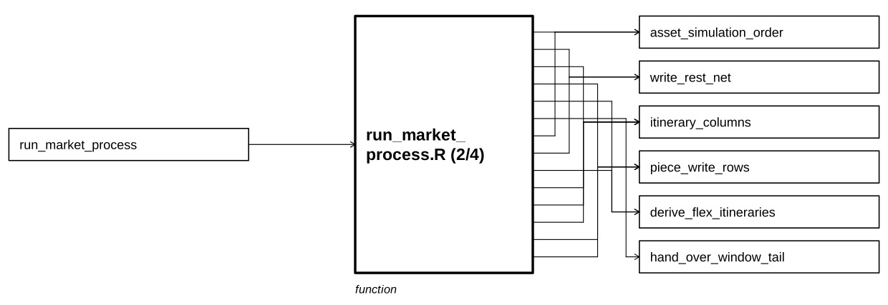

# run_market_process.R &mdash; Called items, block 2 of 4

Block 2 of 4 of [run_market_process.R](run_market_process.md).

## What it calls, in this block

- [asset_simulation_order.R](asset_simulation_order.md)
- [write_rest_net.R](write_rest_net.md)
- [itinerary_columns.R](itinerary_columns.md)
- [piece_write_rows.R](piece_write_rows.md)
- [derive_flex_itineraries.R](derive_flex_itineraries.md)
- [hand_over_window_tail.R](hand_over_window_tail.md)

## Diagram

Also available as [run_market_process__2.svg](run_market_process__2.svg).

---

[Back to run_market_process.R](run_market_process.md) &nbsp;·&nbsp; [Back to the code structure index](../Code_Structure.md)
