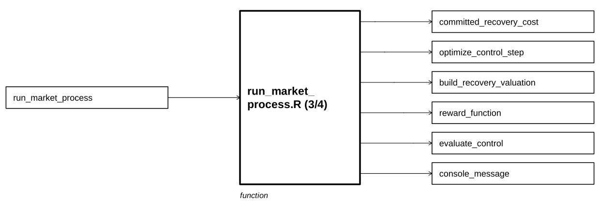

# run_market_process.R &mdash; Called items, block 3 of 4

Block 3 of 4 of [run_market_process.R](run_market_process.md).

## What it calls, in this block

- [committed_recovery_cost.R](committed_recovery_cost.md)
- [optimize_control_step.R](optimize_control_step.md)
- [build_recovery_valuation.R](build_recovery_valuation.md)
- [reward_function.R](reward_function.md)
- [evaluate_control.R](evaluate_control.md)
- [console_message.R](console_message.md)

## Diagram

Also available as [run_market_process__3.svg](run_market_process__3.svg).

---

[Back to run_market_process.R](run_market_process.md) &nbsp;·&nbsp; [Back to the code structure index](../Code_Structure.md)
