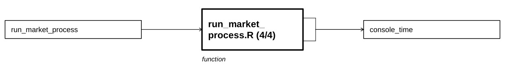

# run_market_process.R &mdash; Called items, block 4 of 4

Block 4 of 4 of [run_market_process.R](run_market_process.md).

## What it calls, in this block

- [console_time.R](console_time.md)

## Diagram

Also available as [run_market_process__4.svg](run_market_process__4.svg).

---

[Back to run_market_process.R](run_market_process.md) &nbsp;·&nbsp; [Back to the code structure index](../Code_Structure.md)
