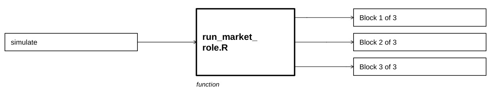

# run_market_role.R

**Function** &nbsp;·&nbsp; `30_Simulation/03_Functions/run_market_role.R`

## Function

Runs, for the current row of the simulation loop, the market of one role: Scheduling (prefix "Sched") or Piloting (prefix "Pilot"). Both roles go through exactly the same steps, and only the prefix of the market columns tells them apart. If no market of the role clears on the row, nothing is done and the objects received are returned as they came. Otherwise the function:

- finds the rows of Main_df that the market covers (its period, its optimization horizon and its control horizon)
- regenerates the weather forecast over the period, in Main_df and in the table of each asset whose type declares it as an input
- runs the market itself over a piece of those rows: the table of the system, taken from Main_df, and one table per asset, all plain data frames (build_market_piece())
- writes the decision into the itineraries of each asset: the _plan columns and the two flexibility itineraries of its table, and the commitments of Main_df (write_itineraries(), applied by apply_table_writes(), which writes the net electricity of the system in Main_df as the sum of that of the assets)
- settles the decision: the differential energy and cost commitments, the elementary market operations and the cash flows of Main_df (settle_market())
- sets the indexes back to their neutral value, so that they do not leak into the next market

Main_df and the tables of the assets are data.tables that are written in place (see "Data frame formatting" in simulate()), so the caller receives the updated tables through the returned list. The indexes of simulation_control are modified only inside the function. They are 0 when the function is called and 0 again when it ends, so simulation_control is not returned.

## Called by

- [simulate.R](simulate.md)

## What it calls, in order of appearance

- [is_market_active.R](is_market_active.md)
- [resolve_market_index.R](resolve_market_index.md) &nbsp;(4 call sites)
- [to_local_indexes.R](to_local_indexes.md)
- [context_forecast_step.R](context_forecast_step.md)
- [copy_asset_inputs.R](copy_asset_inputs.md)
- [console_message.R](console_message.md)
- [build_market_piece.R](build_market_piece.md)
- [resolve_marginal_context.R](resolve_marginal_context.md)
- [run_market_process.R](run_market_process.md)
- [write_itineraries.R](write_itineraries.md)
- [system_net_energy_column.R](system_net_energy_column.md) &nbsp;(2 call sites)
- [apply_table_writes.R](apply_table_writes.md) &nbsp;(3 call sites)
- [settle_market.R](settle_market.md)
- [reset_index_list.R](reset_index_list.md) &nbsp;(4 call sites)

## Blocks

The piece calls 14 items, so it is documented in blocks:

- [Called items, block 1 of 3](run_market_role__1.md)
- [Called items, block 2 of 3](run_market_role__2.md)
- [Called items, block 3 of 3](run_market_role__3.md)

## Input data

- prefix                  : Character. "Sched" or "Pilot".
- row_index               : Integer. Current simulation row index.
- Main_df                 : Data table. The main simulation data frame, with the common and system columns.
- assets                  : Named list, one entry per asset, each with df, the table of the asset (a data table).
- parameters              : Named list. Simulation parameters.
- simulation_control      : Named list. Control metadata. Its parameters element holds the market columns of the current row, and its indexes elements are 0.
- timestamps              : Named list. Timestamp metadata of the whole simulation (time_sec).
- market_time             : POSIXct vector. Sorted unique MarketUTC intervals of the simulation.
- market_index            : Data frame. The market events of both families and the periods they trade, as market_event_index() lists them, built once for the whole simulation.
- full_market_information : Named list of 13 market-event price data frames (read-only).
- market_commitments      : Named list of 12 market-event output data frames.
- economic_analysis       : Named list of economic analysis accumulators (market, slot and index).
- worker_cluster          : Cluster of worker processes of the simulation when parallel = 1, NULL otherwise.
- console_state           : Environment. The record of the console messages of the run, updated in place: market_name_width (width of the market names), and no_history_markets and no_history_instants (what the markets report about the forecast). The first market whose forecast has instants with no history writes a warning, and the totals are reported at the end of the run.

## Output data

- Named list with: Main_df            : Data table. Updated with the net electricity of the system, the commitments, the forecast columns and the market cash flow columns. assets             : Named list. The table of each asset, updated with the absolute *_plan/ *_plan_flex_down/*_plan_flex_up columns. market_commitments : Named list. Updated with the differential energy and cost commitments of the market. economic_analysis  : Named list. Updated with the elementary operations of the market and the totals of its decision.

## Other notes from the file header

### Code outline

1. Market parameters and check that a market clears
2. Indexes
    - 2.1. Global indexes
    - 2.2. Local indexes
3. Forecast context
4. Subset
5. Run market
6. Integrate results
    - 6.1. Itineraries of the assets
    - 6.2. Settlement of the market
7. Reset indexes

### Usage instructions

```r
market_result <- run_market_role(
  prefix                  = "Sched",
  row_index               = CONT_003,
  Main_df                 = Main_df,
  assets                  = assets,
  parameters              = parameters,
  simulation_control      = simulation_control,
  timestamps              = timestamps,
  market_time             = market_time,
  market_index            = market_index,
  full_market_information = full_market_information,
  market_commitments      = market_commitments,
  economic_analysis       = economic_analysis,
  worker_cluster          = worker_cluster,
  console_state           = console_state
  )
```

## Diagram



Also available as [run_market_role.svg](run_market_role.svg).

---

[Back to the code structure index](../Code_Structure.md)
