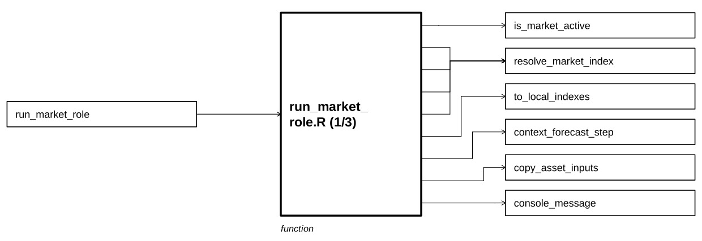

# run_market_role.R &mdash; Called items, block 1 of 3

Block 1 of 3 of [run_market_role.R](run_market_role.md).

## What it calls, in this block

- [is_market_active.R](is_market_active.md)
- [resolve_market_index.R](resolve_market_index.md)
- [to_local_indexes.R](to_local_indexes.md)
- [context_forecast_step.R](context_forecast_step.md)
- [copy_asset_inputs.R](copy_asset_inputs.md)
- [console_message.R](console_message.md)

## Diagram

Also available as [run_market_role__1.svg](run_market_role__1.svg).

---

[Back to run_market_role.R](run_market_role.md) &nbsp;·&nbsp; [Back to the code structure index](../Code_Structure.md)
