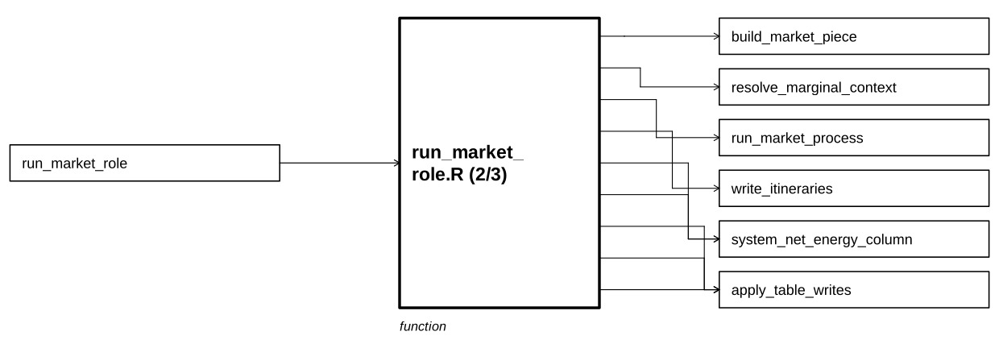

# run_market_role.R &mdash; Called items, block 2 of 3

Block 2 of 3 of [run_market_role.R](run_market_role.md).

## What it calls, in this block

- [build_market_piece.R](build_market_piece.md)
- [resolve_marginal_context.R](resolve_marginal_context.md)
- [run_market_process.R](run_market_process.md)
- [write_itineraries.R](write_itineraries.md)
- [system_net_energy_column.R](system_net_energy_column.md)
- [apply_table_writes.R](apply_table_writes.md)

## Diagram

Also available as [run_market_role__2.svg](run_market_role__2.svg).

---

[Back to run_market_role.R](run_market_role.md) &nbsp;·&nbsp; [Back to the code structure index](../Code_Structure.md)
