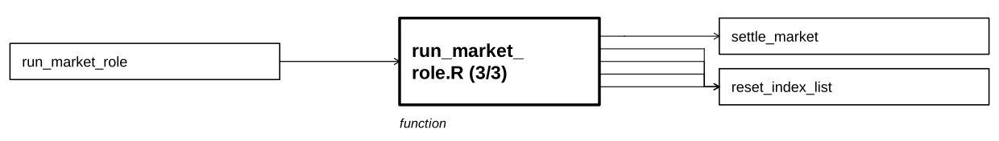

# run_market_role.R &mdash; Called items, block 3 of 3

Block 3 of 3 of [run_market_role.R](run_market_role.md).

## What it calls, in this block

- [settle_market.R](settle_market.md)
- [reset_index_list.R](reset_index_list.md)

## Diagram

Also available as [run_market_role__3.svg](run_market_role__3.svg).

---

[Back to run_market_role.R](run_market_role.md) &nbsp;·&nbsp; [Back to the code structure index](../Code_Structure.md)
