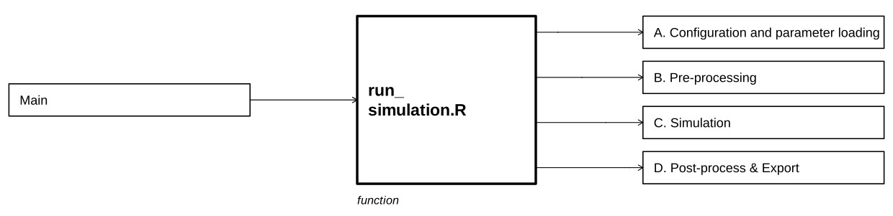

# run_simulation.R

**Function** &nbsp;·&nbsp; `30_Simulation/03_Functions/run_simulation.R`

## Function

Runs a whole simulation of a Model Predictive Control (MPC) strategy applied to building energy management, from the configuration folder to the output files: it loads the data and the parameters, prepares everything the simulation loop reads, runs the loop, completes the economic analysis and writes the results. It is the entry point that Main.R calls once the simulator has been loaded with initialize_simulator().

## Called by

- [Main.R](Main.md)

## What it calls, in order of appearance

- [apply_config_overrides.R](apply_config_overrides.md)
- [build_config_paths.R](build_config_paths.md)
- [load_all_parameters.R](load_all_parameters.md)
- [model_type_contract.R](model_type_contract.md) &nbsp;(2 call sites)
- [subset_period.R](subset_period.md) &nbsp;(2 call sites)
- [console_message.R](console_message.md) &nbsp;(3 call sites)
- [prepare_market_calendar.R](prepare_market_calendar.md)
- [build_market_events.R](build_market_events.md)
- [prepare_flexibility_prices.R](prepare_flexibility_prices.md)
- [prepare_energy_prices.R](prepare_energy_prices.md)
- [prepare_market_information.R](prepare_market_information.md)
- [prepare_commitments.R](prepare_commitments.md)
- [prepare_economic_analysis.R](prepare_economic_analysis.md)
- [simulate.R](simulate.md)
- [finalize.R](finalize.md)
- [write_outputs.R](write_outputs.md)

## Blocks

The code of run_simulation.R is split into 4 blocks, each made of numbered steps. A block that calls more than six items is split again into consecutive steps.

- [A. Configuration and parameter loading](run_simulation__A.md) &nbsp;(steps 1 to 2)
- [B. Pre-processing](run_simulation__B.md) &nbsp;(steps 3 to 12)
    - [B.1. Random seed](run_simulation__B_1.md)
    - [B.2. Climate and period](run_simulation__B_2.md)
    - [B.3. Profiles](run_simulation__B_3.md)
    - [B.4. Markets and prices](run_simulation__B_4.md)
- [C. Simulation](run_simulation__C.md) &nbsp;(step 13)
- [D. Post-process & Export](run_simulation__D.md) &nbsp;(steps 14 to 16)

## Input data

- config_path : Character. Path of the configuration folder, the one that holds 00_Inner_parameters/, 00_Validation/ and every configuration file. The names of the files are read from 04_File_paths.csv.
- overrides   : NULL, for no override, or a data frame with the text columns file, parameter and value, where file is written as @<key>, a key of 04_File_paths.csv (see apply_config_overrides()).
- data_path   : Character. The folder of the input series, Meteo_df.rds and Energy_Prices_df.rds.
- output_path : Character. The folder the output tables are written to. It is created if it does not exist.
- The function also reads, from the simulator environment it is defined in:
- paths: the C++ module. The configuration files, the data files and the output folder of paths are replaced by those of config_path, data_path and output_path.
- the functions and the compiled C++ module.

## Output data

- Named list with the final results of the run:
- Main_df            : Data table. The simulation results of the system, one row per timestep: the common columns and the balances of the system.
- assets             : Named list, one entry per asset, each with df, the table of the asset (a data table), one row per row of Main_df.
- market_commitments : Named list of 12 data frames. The differential energy and cost commitments of every Scheduling and Piloting market.
- economic_analysis  : Named list of 3 data frames (market, decision, slot). The economic analysis, completed with the execution phase.
- execution_time     : List. Timing information of the loop.
- It also writes the output tables, each as .csv and .rds, to output_path (see write_outputs()):
    - Main_df_computed
    - <asset_id>_df_computed, one per asset
    - Sinthetized_df_computed
    - Economic_analysis_market_computed
    - Economic_analysis_decision_computed
    - Economic_analysis_slot_computed
- When parameters$debug_and_config$verbose is TRUE, PREPARE lines are written to the console: the period and the seed, each asset prepared, the price signals and the economic analysis.

## Other notes from the file header

### The MPC concept

A model is used to set the control criteria over a long-term horizon. Typical control horizon is in the range of 24 hours.

### The aim of the optimization

Depending on the selected configuration, the MPC is set to optimize the energy consumption over the control horizon, or even to deliver flexibility to the grid.

### The Building

The building is modeled using a simplified thermal model with parameters defined in external configuration files. The model includes thermal dynamics, HVAC system characteristics, and occupant comfort settings. The relevant file for this is "11_Model_parameters.csv", in the configuration folder of the building.

### Control Strategy

The control strategy is based on predefined modes: the optimizer selects the best mode of every market period within a set of modes (discrete options), each of which fixes the temperature setpoints. The control parameters are defined in:

- "08_Flexibility_Event_Configuration.csv": the parameters that define the flexibility events
- "13_Modes_setpoints.csv": the modes, in the configuration folder of the building

### Weather forecast

MPC requires a forecast of the contextual information. In this case, the weather forecast. Here, two options are considered:

1. Inaccurate forecast: The forecast has some errors compared to the actual weather conditions.
2. Accurate forecast: The forecast matches the actual weather conditions perfectly.

MPC is executed with either of these options but then the "optimal" control actions are applied to the real building model with the actual weather conditions. The forecast parameters for the inaccurate forecast are defined in "15_Forecast_parameters.csv".

### Optimal criteria (reward)

The optimization aims to maximize a reward function that balances energy costs and occupant comfort. The reward parameters are defined in "09_Reward_parameters.csv".

### The overrides

overrides lets a run change some values of the configuration folder without editing it. They are written into a temporary copy of the folder, before anything is loaded (see apply_config_overrides()), so every overridden value is validated against the parameter catalogue as a value of the file would be. The copy is removed when the run ends, however it ends.

### Code outline

A. Configuration and parameter loading

1. Check the arguments and set the paths
2. Load data and model parameters

B. Pre-processing

- B.1 Random seed
3. Fix the random seed (reproducibility of the whole run)

B.2 Climate and period

4. Climate priority of each building (before subsetting, needs full-year trailing averages)
5. Subset Main_df and the table of each asset by month / period

B.3 Profiles

6. Profiles of each asset

B.4 Markets and prices

7. Initialise market columns in Main_df, and the table of the market events
8. Flexibility generation (conditional)
9. Energy/flexibility price signals (buy/sell derivation)
10. Build future-horizon price matrices

11. Initialise market output matrices (market commitments)

12. Initialise the economic analysis accumulators

C. Simulation

13. Perform simulation

D. Post-process & Export

14. Complete the economic analysis (execution phase and fractions)

15. Export results to files

16. Return the results

### Usage instructions

```r
source(file.path("30_Simulation", "03_Functions",
  "initialize_simulator.R"))
```

```r
sim <- initialize_simulator(
  simulation_path = file.path(getwd(), "30_Simulation")
  )
```

run_simulation <- sim$run_simulation results <- run_simulation(

- config_path = file.path(getwd(), "30_Simulation", "02_Config"),
- overrides   = NULL,
- data_path   = file.path(getwd(), "30_Simulation", "01_Data"),
- output_path = file.path(getwd(), "30_Simulation", "90_Output")

)

## Diagram



Also available as [run_simulation.svg](run_simulation.svg).

---

[Back to the code structure index](../Code_Structure.md)
