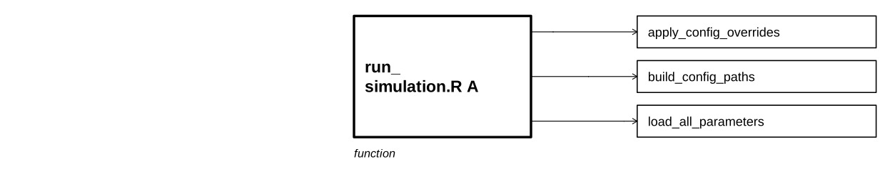

# run_simulation.R &mdash; A. Configuration and parameter loading

Block A of [run_simulation.R](run_simulation.md), steps 1 to 2.

## Steps

- **1.** Check the arguments and set the paths &mdash; [apply_config_overrides.R](apply_config_overrides.md), [build_config_paths.R](build_config_paths.md)
- **2.** Load data and model parameters &mdash; [load_all_parameters.R](load_all_parameters.md)

## Diagram

Also available as [run_simulation__A.svg](run_simulation__A.svg).

---

[Back to run_simulation.R](run_simulation.md) &nbsp;·&nbsp; [Back to the code structure index](../Code_Structure.md)
