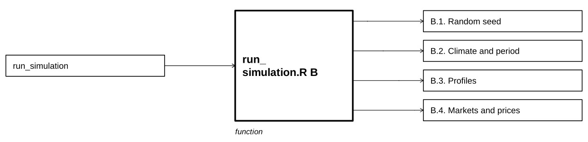

# run_simulation.R &mdash; B. Pre-processing

Block B of [run_simulation.R](run_simulation.md), steps 3 to 12.

## Steps

- **3.** Fix the random seed (reproducibility of the whole run) &mdash; inline code in run_simulation.R
- **4.** Climate priority (before subsetting, needs full-year trailing averages) &mdash; [model_type_contract.R](model_type_contract.md)
- **5.** Subset Main_df and the table of each asset by month / period &mdash; [subset_period.R](subset_period.md), [console_message.R](console_message.md)
- **6.** Profiles of each asset &mdash; [model_type_contract.R](model_type_contract.md), [console_message.R](console_message.md)
- **7.** Initialise market columns in Main_df, and the table of the &mdash; [prepare_market_calendar.R](prepare_market_calendar.md), [build_market_events.R](build_market_events.md)
- **8.** Flexibility generation (conditional) &mdash; [prepare_flexibility_prices.R](prepare_flexibility_prices.md)
- **9.** Energy/flexibility price signals (buy/sell derivation) &mdash; [prepare_energy_prices.R](prepare_energy_prices.md), [console_message.R](console_message.md)
- **10.** Build future-horizon price matrices &mdash; [prepare_market_information.R](prepare_market_information.md)
- **11.** Initialise market output matrices (market commitments) &mdash; [prepare_commitments.R](prepare_commitments.md)
- **12.** Initialise the economic analysis accumulators &mdash; [prepare_economic_analysis.R](prepare_economic_analysis.md)

## Parts

The steps of the block are organised in 4 groups:

- [B.1. Random seed](run_simulation__B_1.md) &nbsp;(step 3)
- [B.2. Climate and period](run_simulation__B_2.md) &nbsp;(steps 4 to 5)
- [B.3. Profiles](run_simulation__B_3.md) &nbsp;(step 6)
- [B.4. Markets and prices](run_simulation__B_4.md) &nbsp;(steps 7 to 12)

## Diagram

Also available as [run_simulation__B.svg](run_simulation__B.svg).

---

[Back to run_simulation.R](run_simulation.md) &nbsp;·&nbsp; [Back to the code structure index](../Code_Structure.md)
