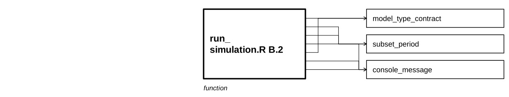

# run_simulation.R &mdash; B.2. Climate and period

Part 2 of 4 of block [B. Pre-processing](run_simulation__B.md) of [run_simulation.R](run_simulation.md).

## Steps

- **4.** Climate priority (before subsetting, needs full-year trailing averages) &mdash; [model_type_contract.R](model_type_contract.md)
- **5.** Subset Main_df and the table of each asset by month / period &mdash; [subset_period.R](subset_period.md), [console_message.R](console_message.md)

## Diagram

Also available as [run_simulation__B_2.svg](run_simulation__B_2.svg).

---

[Back to block B](run_simulation__B.md) &nbsp;·&nbsp; [Back to run_simulation.R](run_simulation.md) &nbsp;·&nbsp; [Back to the code structure index](../Code_Structure.md)
