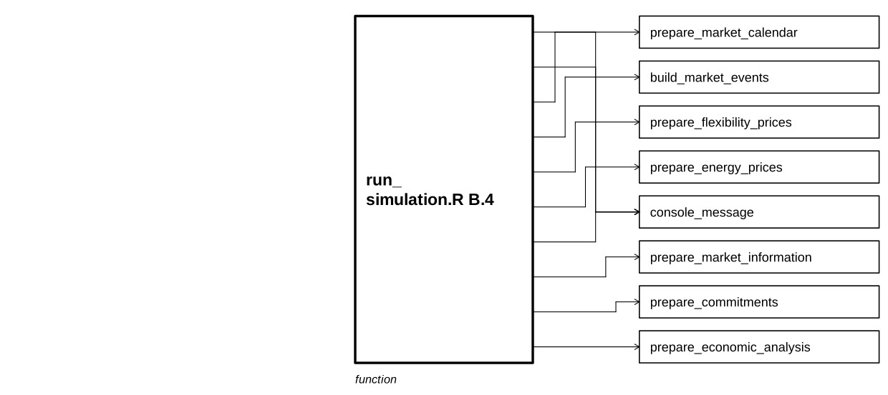

# run_simulation.R &mdash; B.4. Markets and prices

Part 4 of 4 of block [B. Pre-processing](run_simulation__B.md) of [run_simulation.R](run_simulation.md).

## Steps

- **7.** Initialise market columns in Main_df, and the table of the &mdash; [prepare_market_calendar.R](prepare_market_calendar.md), [build_market_events.R](build_market_events.md)
- **8.** Flexibility generation (conditional) &mdash; [prepare_flexibility_prices.R](prepare_flexibility_prices.md)
- **9.** Energy/flexibility price signals (buy/sell derivation) &mdash; [prepare_energy_prices.R](prepare_energy_prices.md), [console_message.R](console_message.md)
- **10.** Build future-horizon price matrices &mdash; [prepare_market_information.R](prepare_market_information.md)
- **11.** Initialise market output matrices (market commitments) &mdash; [prepare_commitments.R](prepare_commitments.md)
- **12.** Initialise the economic analysis accumulators &mdash; [prepare_economic_analysis.R](prepare_economic_analysis.md)

## Diagram

Also available as [run_simulation__B_4.svg](run_simulation__B_4.svg).

---

[Back to block B](run_simulation__B.md) &nbsp;·&nbsp; [Back to run_simulation.R](run_simulation.md) &nbsp;·&nbsp; [Back to the code structure index](../Code_Structure.md)
