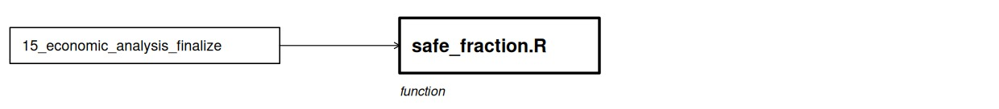

# safe_fraction.R

**Function** &nbsp;·&nbsp; `30_Simulation/03_Functions/safe_fraction.R`

## Function

Divides two vectors element by element, and reports NA where the denominator is zero.

A fraction whose denominator is zero is reported as NA rather than as 0: with no energy traded in a slot, the share of that energy committed in Scheduling (or unwound, or adjusted at Execution) is undefined, and reporting 0 would read as "none of it", which is a different statement.

## Called by

- [15_economic_analysis_finalize.R](15_economic_analysis_finalize.md)

## What it calls, in order of appearance

- Nothing: this piece calls no other piece of the project.

## Input data

- numerator   : Numeric vector.
- denominator : Numeric vector, the same length.

## Output data

- Numeric vector: numerator / denominator, NA where the denominator is zero.

## Other notes from the file header

### Code outline

1. Divide, with NA where the denominator is zero.

### Usage instructions

```r
share <- safe_fraction(qty_scheduling, energy_gross)
```

## Diagram



Also available as [safe_fraction.svg](safe_fraction.svg).

---

[Back to the code structure index](../Code_Structure.md)
