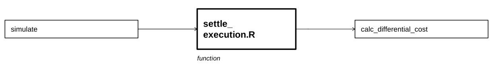

# settle_execution.R

**Function** &nbsp;·&nbsp; `30_Simulation/03_Functions/settle_execution.R`

## Function

Settles the execution of a single time step, for the rows the step has just executed. It is the system side of the execution: it works only with the energy of each row, the prices and the amounts of the markets, and it knows nothing of the building's temperatures, modes or setpoints. The physics of the step is run by implement_control_step() before the settlement. The function writes nothing: it returns the cash flows of the rows, and the simulation loop applies them. For each row it values:

- the deviation of the executed energy from the last committed plan, with calc_differential_cost(). E_orig is the net electricity of the system in the plan and E_new is the one in the executed itinerary, so this values the deviation from what was planned, not the whole executed energy from zero
- the distribution cost, settled on the net energy each time step exchanges with the grid, market and deviations combined: minus the unit distribution cost times the absolute executed net energy. It is always an expense
- the net cost of the row: the cash flow already accumulated by the markets that traded the row, plus the deviation cash flow

## Called by

- [simulate.R](simulate.md)

## What it calls, in order of appearance

- [calc_differential_cost.R](calc_differential_cost.md)

## Input data

- energy_plan       : Numeric vector. Net electricity of the system in the plan, one value per executed row (kWh).
- energy_exec       : Numeric vector. Net electricity of the system in the executed itinerary, as long as energy_plan (kWh).
- price_import_buy  : Numeric vector. Unit price of a new import commitment, as long as energy_plan.
- price_import_sell : Numeric vector. Unit price of undoing an import commitment, as long as energy_plan.
- price_export_buy  : Numeric vector. Unit price of undoing an export commitment, as long as energy_plan.
- price_export_sell : Numeric vector. Unit price of a new export commitment, as long as energy_plan.
- price_distribution: Numeric vector. Unit distribution cost, as long as energy_plan.
- market_net_cost   : Numeric vector. Cash flow already accumulated for each row by the markets that traded it, as long as energy_plan.

## Output data

- Named list of numeric vectors, each as long as energy_plan: deviations_net_cost : Cash flow of the deviation of the executed energy from the plan. distribution_cost   : Distribution cost of the executed energy (<= 0). net_cost            : market_net_cost + deviations_net_cost.

## Other notes from the file header

### Sign convention

Every money signal follows the same sign convention: positive = income, negative = expense. Elec_flex_execution_revenue_h and Elec_flex_deviations_net_cost_h are reserved for the execution of explicit flexibility, which is not simulated yet, so nothing writes to them today and both stay 0 for every row. When they are written, they must carry the same sign, exactly like every other economic column. Their consumer, finalize(), adds them together to get the executed-flexibility cash flow; it does not negate either of them. Writing Elec_flex_deviations_net_cost_h as a positive "cost" magnitude would therefore flip the sign of that cash flow.

### Code outline

1. Deviation cash flow
2. Distribution cost
3. Net cost
4. Return

### Usage instructions

```r
settlement <- settle_execution(
  energy_plan        = system_net_energy(Main_df, "plan")[new_rows],
  energy_exec        = system_net_energy(Main_df, "exec")[new_rows],
  price_import_buy   = Main_df$Elec_unit_cost_import_buy[new_rows],
  price_import_sell  = Main_df$Elec_unit_cost_import_sell[new_rows],
  price_export_buy   = Main_df$Elec_unit_cost_export_buy[new_rows],
  price_export_sell  = Main_df$Elec_unit_cost_export_sell[new_rows],
  price_distribution = Main_df$Elec_unit_cost_distribution[new_rows],
  market_net_cost    = Main_df$Elec_market_net_cost_h[new_rows]
  )
```

## Diagram



Also available as [settle_execution.svg](settle_execution.svg).

---

[Back to the code structure index](../Code_Structure.md)
