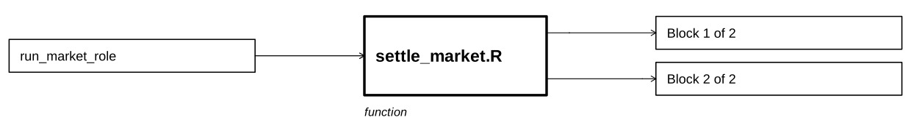

# settle_market.R

**Function** &nbsp;·&nbsp; `30_Simulation/03_Functions/settle_market.R`

## Function

Settles the decision of a single Scheduling or Piloting market, for the current simulation step. It is the system side of the market process: it works only with energy per market interval, commitments, prices and amounts, and it knows nothing of the building's temperatures, modes or setpoints. The itineraries of the building are written by write_itineraries() before the settlement runs. The function never writes into Main_df: it returns the writes, and the simulation loop (run_market_role()) applies them. It:

- locates the market row of the current step and the target market intervals covered by this market's control horizon
- attributes each target interval to the economic_analysis$market row that reports it
- aggregates (SUM) the energy before and after the decision per target interval, for:
    - the base energy (the net electricity of the system in the plan)
    - the energy with flexibility (the net electricity of the system in the downward itinerary)
    - the explicit flexibility of each leg
- accumulates the differential energy commitments into these market_commitments matrices:
    - net/buy/sell
    - their _flex counterparts
    - the explicit flexibility buy/sell matrices
- accumulates the net cash flow of the explicit-flexibility service (both down and up legs, for both Scheduling and Piloting) into market_commitments$Elec_flex_Cost_plan_df and returns its spread over Main_df$Elec_flex_commitment_revenue_h as an addition; it also adds the sold/bought-back totals to this decision's row of economic_analysis$decision, as Flex_sell_revenue (income, +=) and Flex_purchase_cost (expense, -=)
- accumulates the net cash flow of the energy commitment (the base energy track, for both market families) into market_commitments$Elec_Cost_plan_df and returns its spread over Main_df$Elec_market_net_cost_h as an addition; it also splits the same differential into its elementary buy/rebuy/sell/resell operations (split_market_operation()) and adds their totals to this decision's row of economic_analysis$decision, as Energy_sell_revenue (income, +=) and Energy_purchase_cost (expense, -=)
- books the total reward of this decision on its row of economic_analysis$decision: the sum of the per-timestep rewards over the optimization horizon, which is the total the optimizer maximised.

Only two things are committed: the energy of the _plan itinerary and the phase-1 flexibility. The energy of the Recovery Phase is contingent on the service being called, so it is valued by reward_function() to steer the decision but never settled here. Every money signal follows the same sign convention: income positive, expense negative. full_market_information and market_commitments have one row per market event (not one row per market-resolution interval), while their future-step columns still refer to market-resolution-grid offsets. Column offsets (col_j) are therefore computed against market_time (the full market-resolution grid, used only for this arithmetic), while actual matrix reads/writes are indexed by row_m, the row of the current event within full_market_information/ market_commitments' own (sparse) row set. The event is keyed by the market interval its clearing instant falls in (instant_market_slot()), the same key those matrices and economic_analysis were built with, while every target slot is a MarketUTC interval: the interval of the time steps the market controls.

## Called by

- [run_market_role.R](run_market_role.md)

## What it calls, in order of appearance

- [instant_market_slot.R](instant_market_slot.md)
- [system_net_energy.R](system_net_energy.md) &nbsp;(3 call sites)
- [value_flex_operation.R](value_flex_operation.md) &nbsp;(2 call sites)
- [add_to_table_cells.R](add_to_table_cells.md) &nbsp;(8 call sites)
- [propagate_unit_value.R](propagate_unit_value.md)
- [split_market_operation.R](split_market_operation.md)
- [propagate_differential_cost.R](propagate_differential_cost.md)
- [accumulate_market_operation.R](accumulate_market_operation.md)

## Blocks

The piece calls 8 items, so it is documented in blocks:

- [Called items, block 1 of 2](settle_market__1.md)
- [Called items, block 2 of 2](settle_market__2.md)

## Input data

- prefix              : Character. "Sched" or "Pilot". Says whether the target slots count towards economic_analysis$slot's "committed in Scheduling" fraction. It does not select an energy track: both families settle the base energy of the _plan itinerary.
- row_index           : Integer. Current simulation row index (CONT_003).
- clearing_time       : POSIXct scalar. Clearing instant of the market (the time of row row_index).
- control_rows        : Integer vector. Rows of Main_df that the market controls (its control horizon).
- energy_before       : Data frame, one row per row of Main_df, with the energy before the decision:
    - MarketUTC: market interval of the row
    - the net electricity of the system in the plan and in the downward itinerary (kWh, columns named by system_net_energy_column())
    - Elec_flex_down_plan and Elec_flex_up_plan: the flexibility committed on each leg (kWh)
- energy_after        : Data frame. The same columns, after the decision: the itineraries as write_itineraries() writes them. They are also the weights used to spread the cash flow of an interval over its rows.
- reward_by_step      : Numeric vector. Per-timestep Reward of the decision over its optimization horizon.
- market_time         : POSIXct vector. Sorted unique MarketUTC intervals on the full market-resolution grid; used only to compute future-step column offsets (col_j), not as the matrices' row set.
- full_market_information : Named list of 13 market-event price data frames (read-only), as built by prepare_market_information().
- market_commitments  : Named list of 12 market-event output data frames, as built by prepare_commitments().
- economic_analysis   : Named list of economic-analysis accumulators (market, slot, decision and the index sub-list), as built by prepare_economic_analysis().
- parameters          : Named list. Model parameters; reads parameters$market$market_resolution to key the event.

## Output data

- Named list with: main_df_writes     : List of writes for Main_df, in the order in which they have to be applied. Each element is a list with:
    - column : Character. Column of Main_df.
    - rows   : Integer vector. Rows of Main_df.
    - value  : Numeric vector, as long as rows.
    - mode   : Character. "add": the values are added to the current ones.

The writes are the Elec_flex_commitment_revenue_h and Elec_market_net_cost_h spreads over the rows of each target interval.

market_commitments : Named list. Updated with the differential energy and cost commitments of this market execution. Its tables are changed in place (add_to_table_cells()), so the market_commitments passed in holds them too. economic_analysis  : Named list. Updated, in place like market_commitments, with this market execution's elementary operations, on the economic_analysis$market row that owns each target slot and on the economic_analysis$slot row of that slot, and with the totals of this decision on its row of economic_analysis$decision:

- the cost of the energy bought
- the revenue of the energy sold
- the revenue of the flexibility sold
- the cost of the flexibility bought back
- the Reward

Income is positive and expense negative.

## Other notes from the file header

### Code outline

1. Market row and target market intervals
2. Attribution of each target slot to an economic_analysis$market row
3. Per-interval energy before/after the market (SUM aggregation)
4. Accumulate the differential commitments in the output matrices (also resolves the explicit-flexibility net cash flow per interval)
5. Explicit flexibility cost/revenue (Scheduling and Piloting alike)
6. Differential cost of the energy commitment (base energy track, for both market families)
7. Reward of this decision, totalled on its row of economic_analysis$decision

### Usage instructions

```r
settlement <- settle_market(
  prefix                  = "Sched",
  row_index               = CONT_003,
  clearing_time           = Main_df$time[CONT_003],
  control_rows            = simulation_control$indexes_global$idx_ctrl,
  energy_before           = energy_before,
  energy_after            = energy_after,
  reward_by_step          = reward_by_step,
  market_time             = market_time,
  full_market_information = full_market_information,
  market_commitments      = market_commitments,
  economic_analysis       = economic_analysis,
  parameters              = parameters
  )
```

main_df_writes     <- settlement$main_df_writes market_commitments <- settlement$market_commitments economic_analysis  <- settlement$economic_analysis

## Diagram



Also available as [settle_market.svg](settle_market.svg).

---

[Back to the code structure index](../Code_Structure.md)
