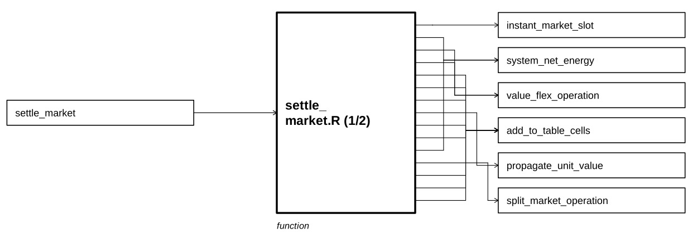

# settle_market.R &mdash; Called items, block 1 of 2

Block 1 of 2 of [settle_market.R](settle_market.md).

## What it calls, in this block

- [instant_market_slot.R](instant_market_slot.md)
- [system_net_energy.R](system_net_energy.md)
- [value_flex_operation.R](value_flex_operation.md)
- [add_to_table_cells.R](add_to_table_cells.md)
- [propagate_unit_value.R](propagate_unit_value.md)
- [split_market_operation.R](split_market_operation.md)

## Diagram

Also available as [settle_market__1.svg](settle_market__1.svg).

---

[Back to settle_market.R](settle_market.md) &nbsp;·&nbsp; [Back to the code structure index](../Code_Structure.md)
