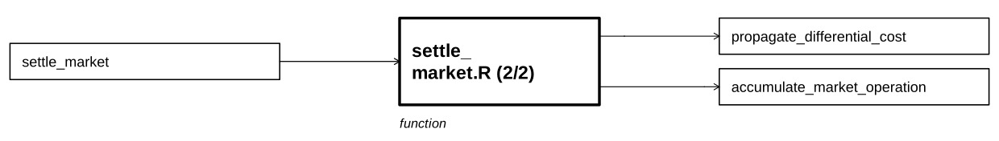

# settle_market.R &mdash; Called items, block 2 of 2

Block 2 of 2 of [settle_market.R](settle_market.md).

## What it calls, in this block

- [propagate_differential_cost.R](propagate_differential_cost.md)
- [accumulate_market_operation.R](accumulate_market_operation.md)

## Diagram

Also available as [settle_market__2.svg](settle_market__2.svg).

---

[Back to settle_market.R](settle_market.md) &nbsp;·&nbsp; [Back to the code structure index](../Code_Structure.md)
