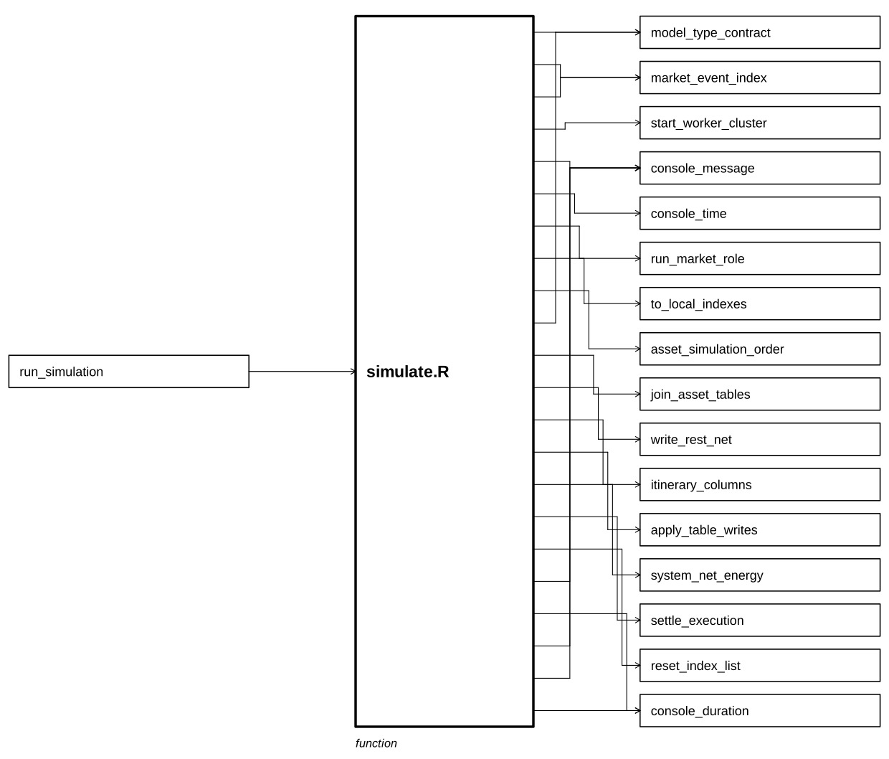

# simulate.R

**Function** &nbsp;·&nbsp; `30_Simulation/03_Functions/simulate.R`

## Function

Runs the main MPC simulation loop and returns the final state of the simulation. For each row of Main_df, it performs:

1) Scheduling process (if Sched_Market_Name != 0)

2) Piloting process   (if Pilot_Market_Name != 0)

3) Execution process  (always)

Scheduling and Piloting each run and integrate their market result the same way, via run_market_role(). First, write_itineraries() gives the absolute update of the *_plan/*_plan_flex_down/ *_plan_flex_up columns of each asset and of the commitments of Main_df. Then settle_market() settles the decision: a differential energy commitment accumulated into market_commitments (its twelve tables are listed under Inputs), using the market row/column mapping given by market_time and the per-interval SUM aggregation of:

- Elec_total_plan
- Elec_total_plan_flex_down
- Elec_flex_down_plan
- Elec_flex_up_plan

then the net cash flow of the explicit flexibility service (both down and up legs, value_flex_operation(), registered for both Scheduling and Piloting) and of the base energy commitment (calc_differential_cost(), the same track for Scheduling and Piloting), each accumulated into its own market_commitments cost matrix and propagated, as a unit value per timestamp, into Main_df$Elec_flex_commitment_revenue_h and Elec_market_net_cost_h respectively. The same two differentials are also broken into their elementary operations (value_flex_operation()/split_market_operation()) and summed, on the decision's own row of economic_analysis$decision, into Flex_sell_revenue/Flex_purchase_cost and Energy_sell_revenue/ Energy_purchase_cost, next to the Reward of the decision. Every one of these signals follows the same sign convention: income positive, expense negative.

## Called by

- [run_simulation.R](run_simulation.md)

## What it calls, in order of appearance

- [model_type_contract.R](model_type_contract.md) &nbsp;(2 call sites)
- [market_event_index.R](market_event_index.md) &nbsp;(2 call sites)
- [start_worker_cluster.R](start_worker_cluster.md)
- [console_message.R](console_message.md) &nbsp;(4 call sites)
- [console_time.R](console_time.md)
- [run_market_role.R](run_market_role.md) &nbsp;(2 call sites)
- [to_local_indexes.R](to_local_indexes.md)
- [asset_simulation_order.R](asset_simulation_order.md)
- [join_asset_tables.R](join_asset_tables.md)
- [write_rest_net.R](write_rest_net.md)
- [itinerary_columns.R](itinerary_columns.md) &nbsp;(3 call sites)
- [apply_table_writes.R](apply_table_writes.md) &nbsp;(2 call sites)
- [system_net_energy.R](system_net_energy.md) &nbsp;(2 call sites)
- [settle_execution.R](settle_execution.md)
- [reset_index_list.R](reset_index_list.md) &nbsp;(4 call sites)
- [console_duration.R](console_duration.md) &nbsp;(3 call sites)

## Input data

- state : Named list. The state of the simulation before the loop:
    - Main_df : Data frame. The main simulation data frame, with the common and system columns, as the preparation steps leave it.
    - assets : Named list, one entry per asset, named by its asset id, each with df, the table of the asset, as the preparation steps leave it.
    - full_market_information : Named list of 13 data frames, one row per market event, created by prepare_market_information() (read-only):
        - Elec_unit_cost_import_buy_df
        - Elec_unit_cost_import_sell_df
        - Elec_unit_cost_export_buy_df
        - Elec_unit_cost_export_sell_df
        - Elec_unit_cost_distribution_df
        - Flex_unit_cost_{down,up}_{com,exec}_{buy,sell}_df (eight tables, one per combination of leg, price type and side)
    - market_commitments : Named list of 12 data frames, one row per market event, created by prepare_commitments():
        - Elec_buy_plan_df
        - Elec_sell_plan_df
        - Elec_net_plan_df
        - Elec_buy_plan_flex_down_df
        - Elec_sell_plan_flex_down_df
        - Elec_net_plan_flex_down_df
        - Elec_flex_down_sell_plan_df
        - Elec_flex_down_buy_plan_df
        - Elec_flex_up_sell_plan_df
        - Elec_flex_up_buy_plan_df
        - Elec_Cost_plan_df
        - Elec_flex_Cost_plan_df
    - economic_analysis : Named list of economic analysis accumulators, created by prepare_economic_analysis():
        - market
        - slot
        - index
    - paths : List. The file paths of the simulator (read-only). Uses paths$cpp_source_path, the C++ modules every worker compiles when parallel == 1.
- parameters : List. Complete parameters list with all sub-lists (read-only). Its asset registry (parameters$assets) gives the type of model and the parameters of the building.

## Output data

- Named list. The final state, with the same elements as state, plus execution_time:
    - Main_df : Data table. Updated with the simulation results of the system, including the incrementally propagated Elec_market_net_cost_h and Elec_flex_commitment_revenue_h columns and (row by row, at Execution) Elec_total_no_flex.
    - assets : Updated with the itineraries and the executed state of each asset.
    - full_market_information : as received.
    - market_commitments : Updated with the differential energy and cost commitments of every Scheduling and Piloting market executed during the simulation.
    - economic_analysis : Updated with the elementary market operations of every Scheduling and Piloting market executed during the simulation.
    - paths : as received.
    - execution_time : List. Timing information for the simulation (t_begin, t_end, t_process in seconds, and the progress estimates of the last step).

## Other notes from the file header

### The state of the simulation

state holds everything the loop reads, other than the parameters, and everything it updates. The loop is its only writer: the functions it calls return what has to be written, and the loop writes it. parameters is only read. The data are held in two kinds of table: Main_df, with what is common to every asset and the balances of the system, and the table of each asset, assets[[asset_id]]$df, one row per row of Main_df. The markets work on a piece of the rows they cover, with the table of the system, taken from Main_df, and one table per asset (build_market_piece()). The execution runs each asset in turn, on a table that joins Main_df with the table of that asset only (join_asset_tables()), and then settles the step once, on the net electricity that Main_df holds. The assets that read the net electricity of the rest of the system (operation reads_rest_net of their type of model) run after the others (asset_simulation_order()), and their table holds the electricity that the others have had in the step (write_rest_net()). What each piece returns is written back to the table that holds each column (apply_table_writes()). The net electricity of the system, in Main_df, is always written as the sum of that of the assets. The state is unpacked once, into objects of this function, and the list itself is not kept. Main_df and the table of each asset become data.tables here (see block 2), and every write the loop makes into them goes through data.table::set(), which writes into the existing columns. So the loop never copies a table, however many other objects refer to it.

### Console

When verbose, the loop writes through console_message(): a line when the run starts, one per market (written by the market when it ends), and one per step, which reports the energy transfer of the assets whatever their number and type. The end of the run and the warnings are written whatever verbose is. The markets note the instants of the forecast that found no history in console_state, and the totals are reported when the run ends.

### Rows of a market

A row holds the state of the building at its instant and the energy of the time step that ends there, so a market controls the rows whose time step lies in its control period: from the row after Period_Begin to the row at Period_End (idx_ctrl), and likewise up to the end of its optimization horizon (idx_horizon). The row at Period_Begin is the initial condition of the optimization: its time step, and its energy, belong to the interval before the period.

### Code outline

1. State: check it and unpack it
2. Data frame formatting (ensure needed columns exist), for Main_df and for the table of each asset
3. Model initialization (set initial temperatures of the building)
4. Compute auxiliary variables, the market-interval index (market_time), the list of the market events (market_index) and create simulation_control object
5. Start the worker cluster of the genetic algorithm, once, when parallel == 1
6. Main simulation loop:
    - 6.1. Load Scheduling/Piloting market parameters for each row
    - 6.2. Scheduling process (conditional, run_market_role()): differential energy into the market commitments, absolute Main_df update, then differential cash flow of the explicit flexibility service and of the base energy commitment
    - 6.3. Piloting process (conditional, run_market_role()): the same steps as Scheduling
    - 6.4. Execution process (always): for each asset, the operation execute_step of its type of model (model_type_contract(); implement_control_step() for a Building) runs its physics of the step and its columns are written into its table. Then, once per row, Elec_total_no_flex is fixed for the executed rows from the net electricity of the system in Main_df, and settle_execution() settles their cash flows from that energy and the prices
    - 6.5. Track execution progress: one console line per step
7. Stop the worker cluster
8. Final state

### Usage instructions

```r
state <- simulate(
  state = list(
  Main_df                 = Main_df,
  assets                  = assets,
  full_market_information = full_market_information,
  market_commitments      = market_commitments,
  economic_analysis       = economic_analysis,
  paths                   = paths
  ),
  parameters = parameters
  )
```

## Diagram



Also available as [simulate.svg](simulate.svg).

---

[Back to the code structure index](../Code_Structure.md)
