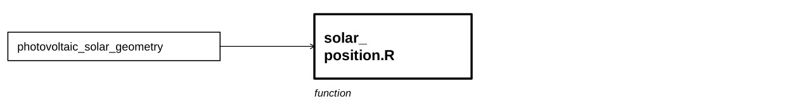

# solar_position.R

**Function** &nbsp;·&nbsp; `30_Simulation/05_Models/02_Photovoltaic/03_Functions/solar_position.R`

## Function

Computes the position of the sun at a place, and the incidence of its rays on a tilted surface, for a vector of instants. It is the geometry of the photovoltaic model: photovoltaic_solar_geometry() calls it once for the whole time grid of an installation, and the model reads its three results from the table of the installation. The position follows the algorithm of the NOAA Solar Calculator, which is based on Meeus, Astronomical Algorithms (1991). It is geometric: it does not include the refraction of the atmosphere. Against the NREL Solar Position Algorithm it differs by less than

- 0.02 degrees for the year 2024 at a latitude of 43 degrees.

The coefficients of the series of the algorithm (the mean longitude and anomaly of the sun, the equation of the centre, the nutation, the obliquity of the ecliptic, the equation of time) and the conversion between degrees and radians belong to the published algorithm. They are structural constants of the calculation, not parameters of the simulation, and so are the Julian date of the Unix epoch and the number of seconds of a day, minutes of a day and degrees of a circle.

## Called by

- [photovoltaic_solar_geometry.R](photovoltaic_solar_geometry.md)

## What it calls, in order of appearance

- Nothing: this piece calls no other piece of the project.

## Input data

- time        : POSIXct vector. The instants, in UTC.
- latitude    : Number. Latitude of the place (deg), positive to the north.
- longitude   : Number. Longitude of the place (deg), positive to the east.
- time_offset : Number. Time added to every instant before the position is computed (min).
- tilt        : Number. Tilt of the surface from the horizontal (deg).
- azimuth     : Number. Direction the surface faces (deg), 0 south, -90 east, 90 west.

## Output data

- Data frame, one row per element of time, with the columns:
- Sun_elevation: elevation of the sun over the horizon (deg), negative with the sun below it.
- Sun_azimuth: azimuth of the sun (deg), 0 south, positive to the west.
- Cos_incidence: cosine of the angle of incidence of the rays on the surface (-).

## Other notes from the file header

### The geometry

Angles are in degrees at the input and at the output, and in radians inside. The azimuth is measured from the south, and it is positive to the west: east -90, south 0, west 90. The sun is taken at the instant of each row plus time_offset, so that the position is that of the instant the radiation of the row stands for.

1. The Julian date and the Julian century of the instant.
2. The declination of the sun and the equation of time.
3. The true solar time, and with it the hour angle.
4. The elevation and the azimuth of the sun.
5. The cosine of the angle between the rays and the normal of the surface, with the tilt and the azimuth of the surface. It is negative when the sun is behind the surface.

### Code outline

1. Julian date and Julian century
2. Declination and equation of time
3. Hour angle
4. Elevation and azimuth of the sun
5. Incidence on the surface

### Usage instructions

```r
position <- solar_position(
  time        = time,
  latitude    = 43.26,
  longitude   = -2.93,
  time_offset = -30,
  tilt        = 30,
  azimuth     = 0
  )
```

## Diagram



Also available as [solar_position.svg](solar_position.svg).

---

[Back to the code structure index](../Code_Structure.md)
