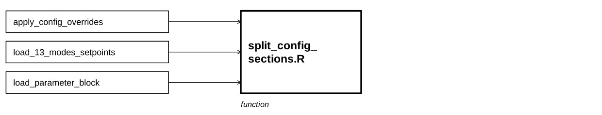

# split_config_sections.R

**Function** &nbsp;·&nbsp; `30_Simulation/03_Functions/split_config_sections.R`

## Function

Splits the lines of a configuration file into its block of parameters and its table. A file holds a block of parameters above its table when its first line that is neither a comment nor blank is the header parameter,value,unit. The block then runs from that header to the first blank line after it, and the table is every line after that blank line that is neither a comment nor blank: its header, its unit row and its rows. A file that does not start with that header has no block: all its lines that are neither a comment nor blank are returned as its table. A file that starts with the header and has no blank line after it is a flat file of parameters: all its lines are returned as its block, and it has no table. The function never stops: the readers decide what a missing part means for them.

## Called by

- [apply_config_overrides.R](apply_config_overrides.md)
- [load_13_modes_setpoints.R](load_13_modes_setpoints.md)
- [load_parameter_block.R](load_parameter_block.md)

## What it calls, in order of appearance

- Nothing: this piece calls no other piece of the project.

## Input data

- lines : Character vector. The lines of the file, as readLines() returns them.

## Output data

- Named list with two integer vectors of line numbers, each one integer(0) when the part is absent:
    - block : the lines of the block, its header first
    - table : the lines of the table, its header first

## Other notes from the file header

### Code outline

1. Find the lines that are neither a comment nor blank
2. Decide whether the file starts with a block, and where it ends

### Usage instructions

```r
lines    <- readLines(path)
```

```r
sections <- split_config_sections(lines)
```

lines[sections$table]

## Diagram



Also available as [split_config_sections.svg](split_config_sections.svg).

---

[Back to the code structure index](../Code_Structure.md)
