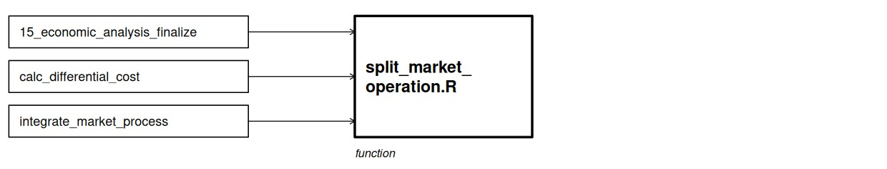

# split_market_operation.R

**Function** &nbsp;·&nbsp; `30_Simulation/03_Functions/split_market_operation.R`

## Function

Same four price regimes and same six branches as calc_differential_cost() (same inputs, same signs, same asymmetric-price logic), but it separates the move from E_orig to E_new into the four elementary market operations that accounting needs to keep apart, instead of a single net cash flow:

buy_new   ("compra")   - taking on, or increasing, a positive

- (import) position. Priced at P_import_buy.

sell_back ("reventa")  - reducing, or closing, a previously held

- positive position, i.e. reselling something
- bought earlier. Priced at P_import_sell.

sell_new  ("venta")    - taking on, or increasing, a negative

- (export) position. Priced at P_export_sell.

buy_back  ("recompra") - reducing, or closing, a previously held

- negative position, i.e. buying back
- something sold earlier. Priced at
- P_export_buy.

For each of the four, both the quantity (always >= 0, in the units of E_orig/E_new) and its value (always >= 0, quantity times the matching price) are returned.

## Called by

- [15_economic_analysis_finalize.R](15_economic_analysis_finalize.md)
- [calc_differential_cost.R](calc_differential_cost.md)
- [integrate_market_process.R](integrate_market_process.md)

## What it calls, in order of appearance

- Nothing: this piece calls no other piece of the project.

## Input data

- E_orig         : Numeric vector. Previous net position per slot.
- E_new          : Numeric vector. New net position per slot.
- P_import_buy   : Numeric vector. Price of a new/incremental positive position.
- P_import_sell  : Numeric vector. Price of unwinding a previous positive position.
- P_export_buy   : Numeric vector. Price of unwinding a previous negative position.
- P_export_sell  : Numeric vector. Price of a new/incremental negative position.
- All six vectors must have the same length.

## Output data

- Named list of eight numeric vectors, all >= 0 and all the same length as the inputs:
    - qty_buy_new, val_buy_new: new purchase, quantity and value
    - qty_buy_back, val_buy_back: buy back of an earlier sale
    - qty_sell_new, val_sell_new: new sale
    - qty_sell_back, val_sell_back: resale of an earlier purchase

## Other notes from the file header

### Relationship with calc_differential_cost()

For every input, the following identity holds exactly:

- calc_differential_cost() = (val_sell_new + val_sell_back) - (val_buy_new  + val_buy_back)

calc_differential_cost() is in fact implemented as a thin wrapper over this function, so the branch logic lives in one place only.

### Code outline

1. Loop over slots, mirroring calc_differential_cost()'s six branches, and assign each branch's magnitude and value to the corresponding elementary operation.

### Usage instructions

```r
op <- split_market_operation(E_orig, E_new, P_import_buy, P_import_sell, P_export_buy, P_export_sell)
```

energy_bought   <- op$qty_buy_new energy_resold   <- op$qty_sell_back

## Diagram



Also available as [split_market_operation.svg](split_market_operation.svg).

---

[Back to the code structure index](../Code_Structure.md)
