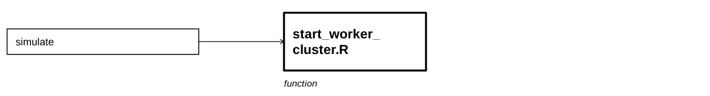

# start_worker_cluster.R

**Function** &nbsp;·&nbsp; `30_Simulation/03_Functions/start_worker_cluster.R`

## Function

Creates the cluster of worker processes in which the genetic algorithm evaluates its candidates when parallel = 1, and prepares it for the whole simulation:

- it registers the cluster as the foreach backend;
- it gives every worker a reproducible random number stream derived from the run's seed;
- it exports every function of the simulator, the environment this function was loaded into;
- it compiles the C++ modules on every worker.

These steps are the expensive part of using workers: compiling the C++ engine alone takes several seconds per worker. They are done once per simulation, and every optimization then only sends the data of its own market (see optimize_modes()).

## Called by

- [simulate.R](simulate.md)

## What it calls, in order of appearance

- Nothing: this piece calls no other piece of the project.

## Input data

- parallel_workers : Numeric. Number of worker processes. With 0, all logical cores but one are used.
- random_seed      : Numeric. Seed of the run. The worker streams are only seeded when it is non-zero, following Main.R's "0 means do not fix" convention.
- cpp_source_path  : Character vector. The C++ modules of the types of model, one .cpp file each, compiled on every worker.

## Output data

- The cluster object returned by makeCluster(), registered as the foreach backend. The caller stops it with stopCluster() when the simulation ends.

## Other notes from the file header

### What a worker holds

A worker is a process of its own, dedicated to the genetic algorithm. It holds the functions of the simulator in its global environment, where they call each other, and its own compiled C++ engine there.

### Code outline

1. Create the cluster and register it as the foreach backend
2. Seed the random number stream of every worker
3. Export every function of the simulator
4. Compile the C++ modules on every worker

### Usage instructions

```r
worker_cluster <- start_worker_cluster(
  parallel_workers = parameters$debug_and_config$parallel_workers,
  random_seed      = parameters$debug_and_config$random_seed,
  cpp_source_path  = paths$cpp_source_path
  )
```

## Diagram



Also available as [start_worker_cluster.svg](start_worker_cluster.svg).

---

[Back to the code structure index](../Code_Structure.md)
