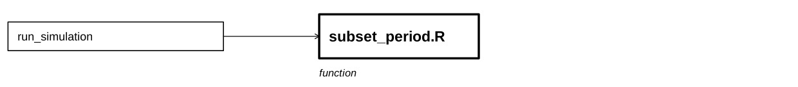

# subset_period.R

**Function** &nbsp;·&nbsp; `30_Simulation/03_Functions/subset_period.R`

## Function

Cuts a table of the simulation down to the period to simulate, so that a short run (for testing or diagnosis) needs no change to the data files. It is applied to Main_df and to the table of each asset alike: the rows it keeps depend only on the time column, which the tables share, so they keep the same rows. Two parameters select the period:

- month_subset: 0 keeps the whole year; a value from 1 to 12 keeps only the rows of that month
- period_subset: 0 keeps every remaining row; any other value keeps only that many rows, counted from the start, or all of them if there are fewer

The month is applied first, then the number of rows. It is meant to run after prepare_climate.R, which needs the whole year to tag the first days of the period.

## Called by

- [run_simulation.R](run_simulation.md)

## What it calls, in order of appearance

- Nothing: this piece calls no other piece of the project.

## Input data

- simulation_table : data frame, Main_df or the table of an asset, with its time column, still covering the whole year.
- month_subset     : Integer, or NULL. parameters$debug_and_config$ month_subset. 0 or NULL keeps the whole year.
- period_subset    : Numeric, or NULL. parameters$debug_and_config$ period_subset. 0 or NULL keeps every row.

## Output data

- simulation_table, cut to the selected month and number of rows.
- Nothing else is modified.

## Other notes from the file header

### Code outline

1. Keep the rows of the selected month, if one is selected.
2. Keep the first period_subset rows, if a number is set.

### Usage instructions

```r
Main_df <- subset_period(
  simulation_table = Main_df,
  month_subset     = parameters$debug_and_config$month_subset,
  period_subset    = parameters$debug_and_config$period_subset
  )
```

## Diagram



Also available as [subset_period.svg](subset_period.svg).

---

[Back to the code structure index](../Code_Structure.md)
