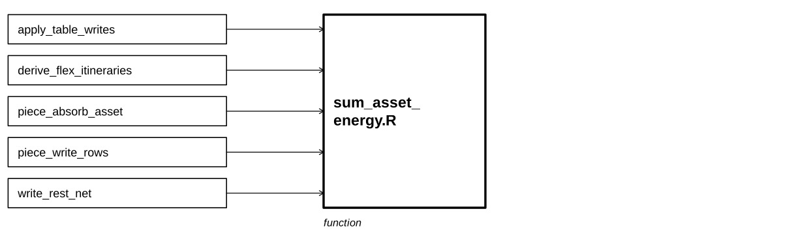

# sum_asset_energy.R

**Function** &nbsp;·&nbsp; `30_Simulation/03_Functions/sum_asset_energy.R`

## Function

Gives the net electricity of the system on some rows, for one or more itineraries: the sum over the assets of the column of each itinerary in the table of each asset. Main_df holds this sum in the column of the same name (system_net_energy_column()), and it is written from here every time the energy of an asset changes. With a single asset the sum is that asset's column itself: no value is added to it, so it is the same number. Its internal objects are removed with rm(list = ), which does not call match.call() as rm() with names does: this function runs several times for every candidate of the genetic algorithm.

## Called by

- [apply_table_writes.R](apply_table_writes.md)
- [derive_flex_itineraries.R](derive_flex_itineraries.md)
- [piece_absorb_asset.R](piece_absorb_asset.md)
- [piece_write_rows.R](piece_write_rows.md)
- [write_rest_net.R](write_rest_net.md)

## What it calls, in order of appearance

- Nothing: this piece calls no other piece of the project.

## Input data

- assets : Named list, one entry per asset, each with df, the table of the asset.
- columns : Character vector. One or more columns of the net electricity of an itinerary, as system_net_energy_column() names them.
- rows   : Integer vector. The rows to sum, rows of every table of an asset alike.

## Output data

- Named list, one numeric vector per column of columns, with one value per element of rows: the net electricity of the system on each row, in kWh.

## Other notes from the file header

### Code outline

1. Check the columns in every table
2. Add the columns of every asset

### Usage instructions

```r
net <- sum_asset_energy(assets, c("Elec_total_plan"), rows)[[1]]
```

### Exceptions and special cases

- A table of an asset without one of the columns stops the run.

## Diagram



Also available as [sum_asset_energy.svg](sum_asset_energy.svg).

---

[Back to the code structure index](../Code_Structure.md)
