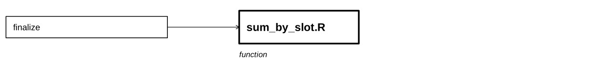

# sum_by_slot.R

**Function** &nbsp;·&nbsp; `30_Simulation/03_Functions/sum_by_slot.R`

## Function

Adds a per-timestep quantity of Main_df up into one total per market slot of the economic analysis, in the order of that table's slots.

The grouping is done on the numeric form of the timestamps, not on their text form, so that the aggregation cannot be broken by a locale or timezone difference in how a POSIXct prints. A slot with no Main_df row would come back as NA from the match, so it is forced to 0: nothing was delivered there.

## Called by

- [finalize.R](finalize.md)

## What it calls, in order of appearance

- Nothing: this piece calls no other piece of the project.

## Input data

- values       : Numeric vector, one entry per row of Main_df.
- slot_group   : Numeric vector, the same length as values: the market slot of each row, as.numeric(Main_df$MarketUTC).
- slot_targets : Numeric vector: the slots of the economic analysis, as.numeric(economic_analysis$slot$time), in the order the totals are wanted.

## Output data

- Numeric vector, one total per entry of slot_targets, 0 where no row belongs to the slot.

## Other notes from the file header

### Code outline

1. Add the values up per slot, and place each total on its target slot.

### Usage instructions

```r
energy_in <- sum_by_slot(pmax(Main_df$Elec_total_exec, 0),
  slot_group, slot_targets)
```

## Diagram



Also available as [sum_by_slot.svg](sum_by_slot.svg).

---

[Back to the code structure index](../Code_Structure.md)
