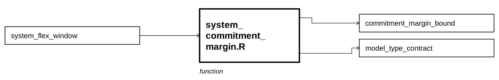

# system_commitment_margin.R

**Function** &nbsp;·&nbsp; `30_Simulation/03_Functions/system_commitment_margin.R`

## Function

Applies the commitment margin to a flexibility window of the system, over the rows of the guard zone of its Commitment Phase. The margin is one, of the set of assets that contribute to the window: it is kept by their net electricity, against the limit of the set, and not by each asset on its own.

Why the margin exists
A window is sold against a concrete itinerary, and every market that clears afterwards derives it again. An itinerary pinned at the limit of what the assets can draw cannot absorb any change, however small. Leaving flexibility_commitment_margin of electricity unused, in every market interval, is what gives the next market something to work with.

The band of the set

Each asset gives, row by row, the electricity it draws at the limit of the leg (its margin data): at the ceiling of the window upward, at its floor downward. The limit of the set is their sum, and commitment_margin_bound() turns it into the band of every market interval: upward, the net electricity stays at least the margin below the limit of the set; downward, at least the margin above it. An asset that does not contribute to the window holds its plan, so the plan is its floor and its ceiling in that window. It adds the same electricity to the net and to the limit, and is left out of both.

How the set is brought inside the band

All the assets contribute with the same fraction of flexibility. In a market interval whose net leaves the band, the departure of every asset from its plan is scaled by one same factor between 0 and 1, found by bisection on the net electricity of the interval, with flexibility_commitment_bisection_steps halvings. When the plan of the set is already outside the band, the interval has no service to offer and every asset keeps its plan in it; when the itinerary the assets drew is already inside, nothing is scaled. With a single asset, the asset fits itself inside the band, through the operation margin_fit of its type of model (for a building, apply_commitment_margin(), in compiled code). It is the same rule, and it is faster.

The minimum flexibility

A new window sells, in each market interval, nothing or at least the minimum the system gives for the interval (minimum_flexibility times the length of the interval). Once the interval is inside the band, what it sells is measured in electricity, on the net, with the electrical model of each asset (the operation margin_energy of its type of model), as the economic chain measures it: the net electricity of the itinerary below the plan downward, above it upward. An interval that sells something, but less than its minimum, is brought back to the plan in every asset and sells nothing. A window that restates a commitment already sold sells nothing new, so the minimum is not applied to it: what an earlier market sold is kept, even below the minimum.

## Called by

- [system_flex_window.R](system_flex_window.md)

## What it calls, in order of appearance

- [commitment_margin_bound.R](commitment_margin_bound.md)
- [model_type_contract.R](model_type_contract.md)

## Input data

- All the vectors are the same length, one entry per row of the guard zone of the Commitment Phase. margins         : Named list, one entry per asset that contributes to the window, named by its asset_id: its margin data, as its type of model gives it (for a building, building_margin_data()). Reads:
    - plan and profile: named lists of numeric vectors, the quantities the asset moves, in the plan and in the itinerary it drew before the margin
    - limit_energy: numeric vector, the electricity (kWh) of each row at the limit of the leg

The rest is read by the operations of the asset.

market_slot     : Vector. The market interval each row belongs to. delta_t_h       : Numeric vector. Timestep of each row in hours. leg             : Character, "up" or "down". enforce_minimum : Logical scalar. TRUE for a new window, whose intervals must sell nothing or at least their minimum; FALSE for a window that restates a commitment already sold. parameters      : Named list. Reads:

- parameters$assets, the asset registry, whose entries are handed to the operations of their types of model
- parameters$control$ flexibility_commitment_bisection_steps
- parameters$computing$flex_energy_tol (kWh), the energy below which an interval sells nothing
- what commitment_margin_bound() reads

## Output data

- Named list, one entry per entry of margins, with the same names:
- the quantities the asset moves after the margin, a named list of numeric vectors in the shape of its profile (for a building, list(Q_heat, Q_cool)). An interval that has no service to offer, or that would sell less than its minimum, comes back equal to the plan in every asset.

## Other notes from the file header

### Code outline

1. The band of the set
2. Bring the set inside the band
    - 2.1. A single asset
    - 2.2. Several assets, with one factor
3. Bring back to the plan the intervals below their minimum

### Usage instructions

```r
margined <- system_commitment_margin(
  margins         = list(Building_001 = margin),
  market_slot     = market_slot,
  delta_t_h       = delta_t_h,
  leg             = "down",
  enforce_minimum = TRUE,
  parameters      = parameters
  )
```

margined$Building_001$Q_heat

## Diagram



Also available as [system_commitment_margin.svg](system_commitment_margin.svg).

---

[Back to the code structure index](../Code_Structure.md)
