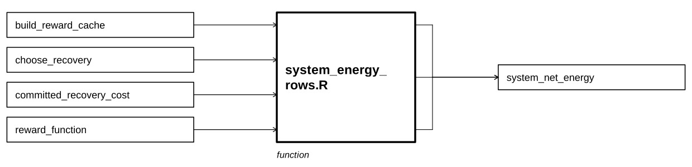

# system_energy_rows.R

**Function** &nbsp;·&nbsp; `30_Simulation/03_Functions/system_energy_rows.R`

## Function

Gives the rows the economic side of the reward values, taken from a period_chunk. It is the boundary between the asset and the system inside the reward: the asset (the building) knows temperatures, modes, setpoints, comfort and the flexibility windows it can draw; the system knows only energy per market interval, commitments, prices and amounts. For each row, the list holds:

- the market interval of the row;
- the net electricity of the system in each of the three itineraries (the plan and the two flexibility legs), read with system_net_energy();
- the phase of each flexibility leg, which says on which rows the leg commits its energy (phase 1) and on which rows that energy would come back if the service were called (phase 3, the Recovery Phase);
- the four energy prices of the row;
- the activation probability of each leg at the row;
- when the system holds assets that store energy, the change of the energy they store on each row in each itinerary, which the caller gives (system_stored_energy()) and which is held as it comes.

Nothing else of the period_chunk reaches economic_terms(), build_reward_cache()'s economic terms or flex_leg_reward_terms(): no temperature, no mode and no setpoint. Every element is the column of period_chunk as it is, so the values the economic side reads are exactly those of the period_chunk.
<https://github.com/robgaray/Model-Predictive-Control-in-Buildings>

## Called by

- [build_reward_cache.R](build_reward_cache.md)
- [choose_recovery.R](choose_recovery.md)
- [committed_recovery_cost.R](committed_recovery_cost.md)
- [reward_function.R](reward_function.md)

## What it calls, in order of appearance

- [system_net_energy.R](system_net_energy.md) &nbsp;(3 call sites)

## Input data

- period_chunk : Data frame. Planning-period data with the columns:
    - MarketUTC
    - the net electricity columns of the plan, plan_flex_down and plan_flex_up itineraries (see system_net_energy())
    - Flex_phase_down_plan
    - Flex_phase_up_plan
    - Elec_unit_cost_import_buy
    - Elec_unit_cost_import_sell
    - Elec_unit_cost_export_buy
    - Elec_unit_cost_export_sell
    - Flex_Probab_down
    - Flex_Probab_up
- stored_energy : NULL, or the change of the stored energy as system_stored_energy() returns it. NULL when no asset stores energy.

## Output data

- Named list, every element one value per row of period_chunk:
    - MarketUTC       : POSIXct. Market interval of each row.
    - net_energy      : Named list with the numeric vectors "plan", "plan_flex_down" and "plan_flex_up" (kWh per row, positive imported).
    - phase           : Named list with the phase code of each leg, "down" and "up".
    - price_row       : Named list with the energy prices of each row, "import_buy", "import_sell", "export_buy" and "export_sell" (EUR/kWh).
    - probability_row : Named list with the activation probability of each leg, "down" and "up".
    - stored_energy   : Only when stored_energy is not NULL: the named list with the numeric vectors "plan", "plan_flex_down" and "plan_flex_up" (kWh per row, positive when energy is stored), as given.

## Other notes from the file header

### Code outline

1. Net electricity of the system in each itinerary
2. Market interval, phases, prices, probabilities and stored energy

### Usage instructions

```r
system_rows <- system_energy_rows(period_chunk)
```

```r
system_rows <- system_energy_rows(period_chunk, stored_energy)
```

## Diagram



Also available as [system_energy_rows.svg](system_energy_rows.svg).

---

[Back to the code structure index](../Code_Structure.md)
