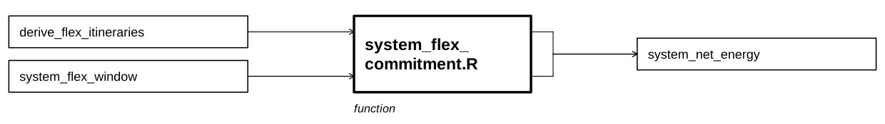

# system_flex_commitment.R

**Function** &nbsp;·&nbsp; `30_Simulation/03_Functions/system_flex_commitment.R`

## Function

Gives, row by row, the flexibility that the system commits on one leg: the difference between the net electricity of the system in the plan and in the itinerary of the leg (system_net_energy()).

- Downward, what the itinerary spends below the plan.
- Upward, what it spends above the plan, bounded at 0 from below.

The commitment is that of the net, because the grid only sees the net: the contributions of the assets to a window add up, and an asset that adds energy can compensate one that sheds it. Upward, the bound at 0 is applied to the net, so a row where the assets together spend less than the plan sells nothing upward. The result is not bounded to the Commitment Phase: the caller keeps the rows of the phase it needs.

## Called by

- [derive_flex_itineraries.R](derive_flex_itineraries.md)
- [system_flex_window.R](system_flex_window.md)

## What it calls, in order of appearance

- [system_net_energy.R](system_net_energy.md) &nbsp;(2 call sites)

## Input data

- period_chunk : Data frame. A chunk with the net electricity of the system in the plan and in the itinerary of the leg (the columns system_net_energy() reads).
- leg          : Character scalar, "down" or "up".

## Output data

- Numeric vector, one value per row of period_chunk: the electricity committed on the leg, in kWh.

## Other notes from the file header

### Code outline

1. Check the leg
2. The difference of the net with the plan

### Usage instructions

```r
committed <- system_flex_commitment(period_chunk, "down")
```

## Diagram



Also available as [system_flex_commitment.svg](system_flex_commitment.svg).

---

[Back to the code structure index](../Code_Structure.md)
