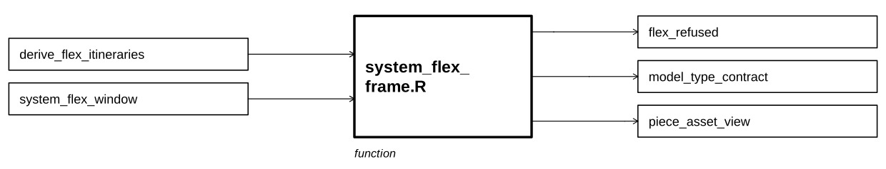

# system_flex_frame.R

**Function** &nbsp;·&nbsp; `30_Simulation/03_Functions/system_flex_frame.R`

## Function

Prepares the frame of one flexibility window of the system, on one leg: everything system_flex_window() needs that does not depend on the fraction of flexibility of the window, nor on the thermal system of a restated upward window. The frame is:

- the rows of the window, its three phases, the rows of its Commitment Phase, their time steps and which of them are in the guard zone;
- the piece with the phases of the window written in the table of the system;
- the operations of the type of model of every asset (model_type_contract()) and its view of that piece (piece_asset_view()).

When a window already sold is restated (derive_flex_itineraries()), system_flex_window() is called many times for the same window, with a different fraction each time, to find the fraction that keeps the commitment. The frame is prepared once for the window and handed to every call, so that this work is not repeated. A call without a frame prepares its own, so the window is the same either way. The rows, the phases and the bounds of the window follow the rules described in the header of system_flex_window().

## Called by

- [derive_flex_itineraries.R](derive_flex_itineraries.md)
- [system_flex_window.R](system_flex_window.md)

## What it calls, in order of appearance

- [flex_refused.R](flex_refused.md)
- [model_type_contract.R](model_type_contract.md)
- [piece_asset_view.R](piece_asset_view.md)

## Input data

- leg                : Character scalar, "down" or "up". The leg the window belongs to.
- piece              : List. The piece of the planning period, as system_flex_window() receives it.
- parameters         : Named list. Model and control parameters. Reads:
    - parameters$assets, the asset registry
    - parameters$control$neutral_phase_timespan and recovery_phase_timespan (h)
    - parameters$computing$main_resolution_sec (s), the time step
    - parameters$joined_cols, the order of the columns of the view of an asset
- simulation_control : Named list. Simulation control object. Reads:
    - indexes_local$i_flex and indexes_local$i_end_control
    - flexibility$commitment_phase_length
    - flexibility$restating and flexibility$restatement_mode, optional

as described in the header of system_flex_window(). It does not read the fractions of flexibility nor hvac_up.

## Output data

- A named list with:
- done         : Named list or NULL. When the window cannot be built whatever its fraction, the answer of system_flex_window() (piece, refusal and contributors): a new window that does not fit by the close of the control horizon ("no_room"), or an upward window with no row in its Commitment Phase. NULL otherwise, and then the other elements hold the frame. When done is not NULL, they are absent.
- window       : Named list. What the system hands each asset, but the fraction of each row and hvac_up:
    - i_flex, the first row of the Commitment Phase
    - rows and phase, the rows of the window and the phase code of each (0 for the initial condition)
    - commitment, the positions in rows of the Commitment Phase
    - delta_t_h, the time step of each of them (h)
    - guard_row, whether each of them is in the guard zone
    - restating, whether the window is restated
    - i_end_control, the last row of the control horizon in the piece
- window_piece : List. The piece with Flex_phase_<leg>_plan of the table of the system set to the phase of each row of the window after its initial condition.
- models       : Named list, by asset_id. The operations of the type of model of each asset.
- views        : Named list, by asset_id. The view of each asset of window_piece.

## Other notes from the file header

### Code outline

1. Read the window
2. Bound the window by the control horizon
3. Take the rows of the window
4. The Commitment Phase
5. Mark the three phases
6. The operations and the view of each asset

### Usage instructions

```r
frame <- system_flex_frame(leg                = "down",
  piece              = piece,
  parameters         = parameters,
  simulation_control = simulation_control)
```

```r
built <- system_flex_window(leg                = "down",
  piece              = piece,
  parameters         = parameters,
  simulation_control = simulation_control,
  frame              = frame)
```

## Diagram



Also available as [system_flex_frame.svg](system_flex_frame.svg).

---

[Back to the code structure index](../Code_Structure.md)
