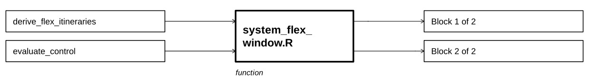

# system_flex_window.R

**Function** &nbsp;·&nbsp; `30_Simulation/03_Functions/system_flex_window.R`

## Function

Builds one flexibility window of the system, on one leg, downward or upward, over a planning period. The window is of the set of assets:

- the system fixes the window: its rows, its three phases, the rows of its Commitment Phase in the guard zone and the fraction of flexibility of each of them;
- each asset drafts its contribution to it, through the operation window_draft of its type of model (model_type_contract());
- the system applies the commitment margin to the set of assets that contribute (system_commitment_margin()): one margin, kept by their net electricity;
- each asset draws its contribution with what the margin left, through the operation window_contribution of its type of model, and applies the technical rules of its type;
- the commitment is that of the net: what the window sells in each market interval is the difference between the net electricity of the system in the itinerary of the leg and in the plan (system_flex_commitment()), and the rules on what a window sells are checked on it.

The window is accepted when at least one asset contributes to it and its net commitment keeps those rules. Otherwise the piece is returned as it came in. An asset may draw the Recovery Phase of the window in more than one way (operation recovery_choices). The window is first built with the first alternative of each of them. When the caller gives a valuation of the Recovery Phase (build_recovery_valuation()), the assets that contribute and offer alternatives draw their contribution again with each of the others, with the same draft and the same margin, and the system keeps the window with the best reward (choose_recovery()). The alternatives differ only in the Recovery Phase, so the commitment of the window is the same in all of them, and the rules on it are checked once. The rows and phases of the window, the piece with the phases written and the operations and view of each asset do not depend on the fraction of flexibility: they are the frame of the window (system_flex_frame()), which a caller that builds the same window with several fractions prepares once and hands over. The window is built on the piece of a market. The phases are written in the table of the system. Each asset drafts and draws in its view of the piece (piece_asset_view()), and what it draws comes back into its table, with the net electricity of the system summed again (piece_absorb_asset()). The piece received is never modified: every write goes to a new piece. The window lives only within this call and within the market that builds it. What leaves the market is the energy each itinerary commits, from which the next market reconstructs the phases (reconstruct_flex_phases()).

## Called by

- [derive_flex_itineraries.R](derive_flex_itineraries.md)
- [evaluate_control.R](evaluate_control.md)

## What it calls, in order of appearance

- [system_flex_frame.R](system_flex_frame.md)
- [system_commitment_margin.R](system_commitment_margin.md)
- [piece_absorb_asset.R](piece_absorb_asset.md) &nbsp;(2 call sites)
- [system_net_energy.R](system_net_energy.md) &nbsp;(2 call sites)
- [system_flex_commitment.R](system_flex_commitment.md) &nbsp;(3 call sites)
- [commitment_margin_bound.R](commitment_margin_bound.md)
- [flex_refused.R](flex_refused.md) &nbsp;(2 call sites)
- [choose_recovery.R](choose_recovery.md)

## Blocks

The piece calls 8 items, so it is documented in blocks:

- [Called items, block 1 of 2](system_flex_window__1.md)
- [Called items, block 2 of 2](system_flex_window__2.md)

## Input data

- leg                : Character scalar, "down" or "up". The leg the window belongs to.
- piece              : List. The piece of the planning period, as build_market_piece() gives it. It must hold the _plan itinerary of every asset simulated in its table, the *_plan_flex_<leg> baseline columns initialized by derive_flex_itineraries(), and the phases in the table of the system.
- parameters         : Named list. Model and control parameters. Reads:
    - parameters$assets, the asset registry, whose entries are handed to the operations of their types of model
    - parameters$control$neutral_phase_timespan and recovery_phase_timespan (h)
    - parameters$computing$main_resolution_sec (s), the time step
    - parameters$computing$flex_energy_tol (kWh)
    - parameters$joined_cols, the order of the columns of the view of an asset
    - what commitment_margin_bound() and system_commitment_margin() read
- simulation_control : Named list. Simulation control object. Reads:
    - indexes_local$i_flex: integer scalar, the first row of the Commitment Phase in the piece, at least 2: the row before it is the initial condition of the window
    - indexes_local$i_end_control: integer scalar, the last row of the control horizon in the piece
    - flexibility$commitment_phase_length: numeric scalar, the duration of the Commitment Phase (h), at most commitment_phase_length_max
    - flexibility$flexibility: numeric scalar in (0, 1], the fraction of flexibility of the rows of the guard zone (1 = full flexibility)
    - flexibility$restating, flexibility$restatement_mode, flexibility$flexibility_projected and flexibility$hvac_up, optional, for a window that is restated (see derive_flex_itineraries()). hvac_up is a list named by asset_id: for a building named there, "heat" or "cool", the system it uses for a restated upward window. It is only read when restating
- recovery_valuation : Named list or NULL (default NULL). The valuation of the Recovery Phase, as build_recovery_valuation() gives it. With NULL every asset draws the Recovery Phase with its first alternative, and no economic function is called.
- frame              : Named list or NULL (default NULL). The frame of the window, as system_flex_frame() gives it for the same leg, piece, parameters and simulation_control (whatever its fractions of flexibility and hvac_up). With NULL the frame is prepared here. A caller that builds the same window with several fractions prepares it once and hands it to every call.

## Output data

- A named list with:
- piece   : List. The piece with the *_plan_flex_<leg> columns of the assets that contribute drawn in their tables over the rows of the window after its initial condition, the net electricity of the system summed again, and Flex_phase_<leg>_plan of the table of the system set to the phase code of each of them (1 Commitment, 2 Neutral, 3 Recovery; 0 elsewhere, as left by derive_flex_itineraries()). A window that is not built returns the piece received.
- refusal : Character scalar or NULL. The reason the window is refused, one of those of flex_refused(), when the window is not built for one of them. NULL when the window is built. A window to which no asset contributes, with no asset refusing it, and an upward window that does not raise the net electricity of its Commitment Phase, are returned as they came in with a NULL refusal.
- contributors : Character vector. The asset_id of each asset that contributes to the window built; empty when the window is returned as it came in. The others refused it, or had nothing to offer on it.
- empty_contributors : Character vector, only when the window is built and some asset accepts it with no energy. The asset_id of each asset that has nothing to offer on a restated window and accepts it with no energy (accepted, from its operation window_draft or window_contribution): it does not refuse the window, and what it does not reach of it is bought again.

## Other notes from the file header

### Rows and instants

A row holds the state of each asset at its instant and the energy of the time step that ends there. The window starts at the instant its first market interval starts, so the row of that instant, the last row of the interval before, is its initial condition: it is simulated as the first row of the window, but it is not recomputed and it belongs to no phase. i_flex is the first row of the Commitment Phase, the first row of that interval. Every phase is a span of instants after the start, so each of them holds whole time steps:

- Commitment - rows in [t(i_flex), t(i_flex) + L)
- Neutral    - rows in [t(i_flex) + L, t(i_flex) + L + R)
- Recovery   - rows in [t(i_flex) + L + R, t(i_flex) + L + R + S)

with L, R and S the lengths of the three phases. The lengths of the Neutral and Recovery Phases are of the system, the same for every asset, so the next market can reconstruct the phases from the net commitment alone. These are the rows reconstruct_flex_phases() reads back.

### The contribution of the assets

Every asset contributes with the same fraction of flexibility, row by row. An asset may contribute nothing:

- it has nothing to offer on the leg (for a building, an upward window with no dominant system, or one that raises nothing);
- its contribution breaks the technical rules of its type (for a building, the recovery does not converge by the close of the control horizon, or the window raises both thermal systems).

The rules are applied within each asset, and an asset that breaks them contributes nothing; the others contribute what they can. When no asset contributes, the window is not built, and the reason of the first asset that refused it, if any, is returned. An asset may accept a restated window with no energy: it has nothing to offer on it, but it does not refuse it (for a battery, what it does not reach of a window already sold is bought again). It does not contribute, and it is returned apart from those that refuse the window.

### The margin of the set

The commitment margin is one, of the set of assets that contribute to the window, and it is applied before they simulate it, because the heat it leaves in the Commitment Phase drives the Neutral and Recovery Phases:

1. every asset drafts its contribution: what it would draw in the Commitment Phase before the margin, and its margin data;
2. on the rows of the guard zone, the system keeps flexibility_commitment_margin of net electricity unused against the limit of the set, scaling the departure of every asset from its plan by one same factor in each market interval, and brings back to the plan the intervals of a new window that would sell less than their minimum (system_commitment_margin());
3. every asset draws its contribution with the heat the margin left.

An asset that then contributes nothing leaves the set, and the margin is applied again to the assets that remain, so that the net of the assets that finally contribute keeps it. With a single asset there is nothing to apply again: the window is either built or refused.

### The net commitment

Two rules on what a new window sells are checked on the net, once the assets have contributed:

- an upward window has to raise the net electricity of the system over its Commitment Phase. A window that consumes less than the plan would sell a load reduction at upward prices;
- each market interval of the Commitment Phase sells nothing or at least minimum_flexibility times the length of the interval, in electricity ("below_minimum"), and the first and the last sell something ("empty_edge"). The window one interval shorter is another candidate of the search, and the next market, which rebuilds the windows from the committed energy, would not see those intervals as part of this one. An interval inside the window that sells nothing is a gap of the window.

The upward rule is checked on every window. The minimum and the edges are rules on what a market sells, and a restated window sells nothing new, so they do not apply to it.

### Code outline

1. The frame of the window: its rows and phases, the piece with the phases written, and the operations and view of each asset (system_flex_frame(), unless the caller hands it over)
2. The fraction of flexibility of each row
3. The contribution of each asset
    - 3.1. The draft of each asset
    - 3.2. The margin of the set and the contributions
4. Check the net electricity of an upward window
5. Check the net commitment of every market interval
6. Choose the Recovery Phase of the assets that offer alternatives
    - 6.1. The window drawn with each alternative
    - 6.2. The choice

### Usage instructions

```r
built <- system_flex_window(leg                = "down",
  piece              = piece,
  parameters         = parameters,
  simulation_control = simulation_control)
```

With a frame prepared once for several fractions:

```r
frame <- system_flex_frame(leg                = "down",
  piece              = piece,
  parameters         = parameters,
  simulation_control = simulation_control)
```

```r
built <- system_flex_window(leg                = "down",
  piece              = piece,
  parameters         = parameters,
  simulation_control = simulation_control,
  frame              = frame)
```

built$piece built$refusal built$contributors

### Exceptions and special cases

- simulation_control$indexes_local$i_flex must be a single row index within the piece, from 2 on: row 1 of a piece is its own initial condition, and the window needs the row before i_flex.
- simulation_control$flexibility$commitment_phase_length must be <= commitment_phase_length_max.
- simulation_control$flexibility$flexibility must be in (0, 1].
- A new window (not restated) whose Commitment, Neutral and Recovery Phases do not fit by i_end_control is refused ("no_room"). The window may end on that row: its last time step ends there.
- A restated window (simulation_control$flexibility$restating) is drawn wherever it falls. Only the rows of its Commitment Phase in the guard zone take simulation_control$flexibility$flexibility and the commitment margin; the other rows take simulation_control$flexibility$flexibility_projected and no margin (see derive_flex_itineraries()). It is not checked for convergence at the close of the control horizon.
- An upward window with no row in its Commitment Phase has nothing to offer, and is returned as it came in with a NULL refusal.
- COMPUTATIONAL COST: each call simulates every asset once over a bounded window (commitment_phase_length + neutral_phase_timespan + recovery_phase_timespan), and once more each time an asset leaves the set and the margin is applied again to the others. It takes one view per asset, in its frame, and does one absorb per contributing asset per call. With a valuation of the Recovery Phase, each asset that contributes and offers alternatives draws its contribution once more for each alternative but the first, and each alternative that changes the electricity is valued (choose_recovery()). The cost of one call does not grow with the optimization horizon. However, evaluate_control()'s nested market-slot loop can call this function O(L^2) times per evaluation (L = number of market slots in the horizon) - see the COMPUTATIONAL COST note in evaluate_control.R's header for the aggregate cost.

## Diagram



Also available as [system_flex_window.svg](system_flex_window.svg).

---

[Back to the code structure index](../Code_Structure.md)
