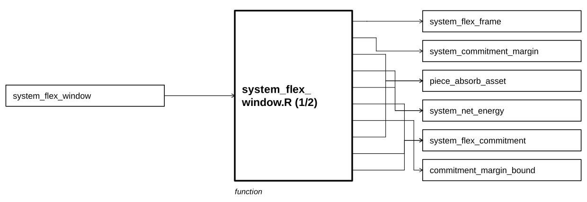

# system_flex_window.R &mdash; Called items, block 1 of 2

Block 1 of 2 of [system_flex_window.R](system_flex_window.md).

## What it calls, in this block

- [system_flex_frame.R](system_flex_frame.md)
- [system_commitment_margin.R](system_commitment_margin.md)
- [piece_absorb_asset.R](piece_absorb_asset.md)
- [system_net_energy.R](system_net_energy.md)
- [system_flex_commitment.R](system_flex_commitment.md)
- [commitment_margin_bound.R](commitment_margin_bound.md)

## Diagram

Also available as [system_flex_window__1.svg](system_flex_window__1.svg).

---

[Back to system_flex_window.R](system_flex_window.md) &nbsp;·&nbsp; [Back to the code structure index](../Code_Structure.md)
