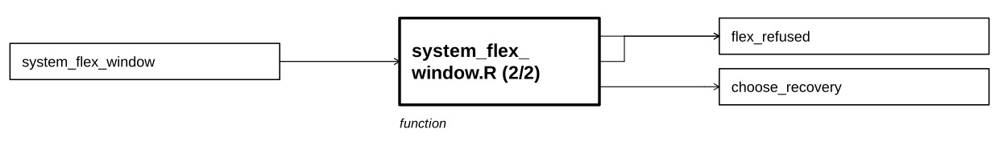

# system_flex_window.R &mdash; Called items, block 2 of 2

Block 2 of 2 of [system_flex_window.R](system_flex_window.md).

## What it calls, in this block

- [flex_refused.R](flex_refused.md)
- [choose_recovery.R](choose_recovery.md)

## Diagram

Also available as [system_flex_window__2.svg](system_flex_window__2.svg).

---

[Back to system_flex_window.R](system_flex_window.md) &nbsp;·&nbsp; [Back to the code structure index](../Code_Structure.md)
