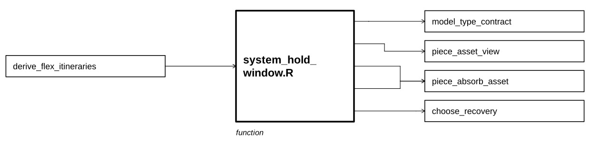

# system_hold_window.R

**Function** &nbsp;·&nbsp; `30_Simulation/03_Functions/system_hold_window.R`

## Function

Holds, within the limits of the equipment of some assets, the part of a flexibility window already sold that the window of the system does not deliver over the new plan. It is called when a window is restated (derive_flex_itineraries()) and some assets refuse to redraw it.

## Called by

- [derive_flex_itineraries.R](derive_flex_itineraries.md)

## What it calls, in order of appearance

- [model_type_contract.R](model_type_contract.md)
- [piece_asset_view.R](piece_asset_view.md)
- [piece_absorb_asset.R](piece_absorb_asset.md) &nbsp;(2 call sites)
- [choose_recovery.R](choose_recovery.md)

## Input data

- piece        : List. The piece being derived, with the windows already restated on it.
- leg          : Character scalar, "down" or "up".
- window_rows  : Integer vector. The rows of the Commitment Phase held. Row 1 is the initial state of the piece and is never held.
- need         : Numeric vector as long as the piece has rows. The energy to hold on each row, in kWh.
- holders      : Character vector. The asset_id of each asset that holds, names of parameters$assets.
- parameters   : Named list. Model and control parameters. Reads the asset registry (parameters$assets), whose entries are handed to the operations of their types of model, and what those operations read, parameters$joined_cols, the order of the columns of the view of a holder, and parameters$computing$flex_energy_tol (kWh).
- hold         : Named list. The window held: phase         - integer vector, one per row of the piece: the phase of the window on the row (1 Commitment, 2 Neutral, 3 Recovery, 0 outside it). i_end_control - the row where the control horizon closes in the piece.
- recovery_valuation : Named list or NULL (default NULL). build_recovery_valuation() gives it: the alternatives for the Recovery Phase and what is needed to value them. With NULL nothing is chosen.

## Output data

- The piece with the electricity itinerary of the leg of each holder carrying its share over window_rows in its table, the net electricity of the system summed again, and Flex_phase_<leg>_plan of the table of the system set to 1 over the rows held and, when an asset that offers alternatives for the Recovery Phase holds energy there, to the phase of the window on its Neutral and Recovery rows.

## Other notes from the file header

### Who holds the window

The commitment of a window is that of the net, and how the assets shared it is not stored. When it is restated, the assets that can redraw it cover what was sold with their common fraction of flexibility (system_flex_window()). What they do not deliver is held by the assets that refuse the window, the holders, each within the limits of its equipment. What is still missing is not held: the commitment the itineraries carry is then smaller than the one sold, and the economic chain books the difference as a re-purchase. When no asset redraws the window, the holders are all the assets, and what they hold is the whole commitment that stands.

### The share of each holder

- A single holder holds what is missing, as far as its equipment allows (the operation window_hold of its type of model).
- Several holders share it in proportion to what each one can hold on each row (the operation hold_room of its type of model): when they can hold all of it together, each one holds the same fraction of its room; otherwise each one holds all its room.

Each holder works in its view of the piece (piece_asset_view()) and writes its share on its electricity itinerary of the leg there. That share comes back into the table of the holder, with the net electricity of the system summed again (piece_absorb_asset()). The phases of a window are of the system: it marks the rows held as Commitment Phase in its own table.

### The Recovery Phase of a window held

A window that is held keeps its Neutral and Recovery Phases after its Commitment Phase. An asset that stores energy, a battery, also has to leave its leg realizable until the close of the control horizon, so it corrects the Recovery Phase of the window it holds (the operation window_hold of its type of model). For that, each holder receives the window held: its phases, the row where the control horizon closes, and, when it offers alternatives for the Recovery Phase, the one to draw it with. The system marks the Neutral and Recovery Phases of the window in its own table when one of the assets that offer alternatives holds energy in the rows held, because the cost of the energy the asset buys or sells in the Recovery Phase is read on the rows marked. An asset that offers none leaves the table as it was. When the valuation is given and one of those assets holds energy, the window is held again with each alternative of the Recovery Phase, with the same shares, and choose_recovery() keeps the piece with the best reward. An alternative that leaves the electricity of every asset as the first one did is not valued.

### Code outline

1. Check the holders
2. The share of each holder
3. Each holder holds its share
4. The system marks the rows held
5. The Recovery Phase of the window held

### Usage instructions

```r
piece <- system_hold_window(piece       = piece,
  leg         = "up",
  window_rows = rows,
  need        = need,
  holders     = names(parameters$assets),
  parameters  = parameters,
  hold        = list(phase = phase,
  i_end_control = 40))
```

## Diagram



Also available as [system_hold_window.svg](system_hold_window.svg).

---

[Back to the code structure index](../Code_Structure.md)
