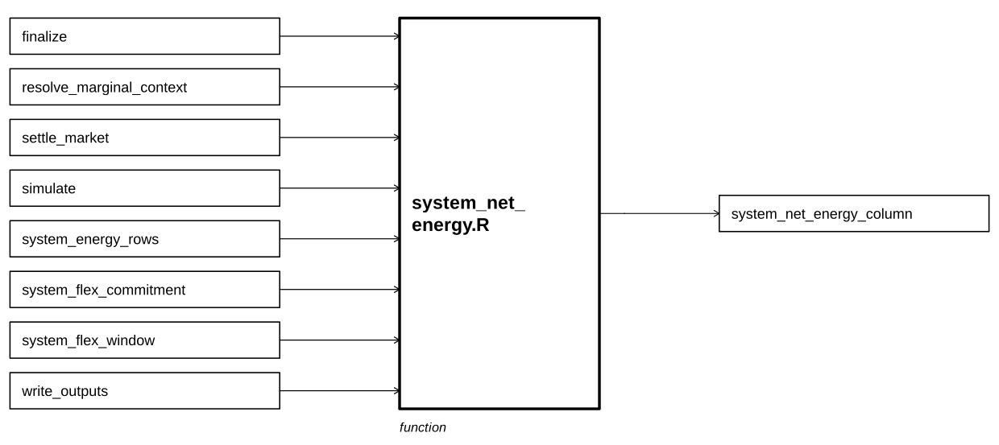

# system_net_energy.R

**Function** &nbsp;·&nbsp; `30_Simulation/03_Functions/system_net_energy.R`

## Function

Gives the net electricity of the system for one itinerary. It is the one place where the economic side reads the energy of the system: the column Elec_total_<itinerary> (kWh per row, positive when imported). Main_df holds it as the sum over the assets of the column of the same name of each asset (sum_asset_energy()). The execution reads the net from Main_df. The piece a market works on still joins Main_df and the table of one building, so there the column is that of the building, which is the sum with a single asset.
<https://github.com/robgaray/Model-Predictive-Control-in-Buildings>

## Called by

- [finalize.R](finalize.md)
- [resolve_marginal_context.R](resolve_marginal_context.md)
- [settle_market.R](settle_market.md)
- [simulate.R](simulate.md)
- [system_energy_rows.R](system_energy_rows.md)
- [system_flex_commitment.R](system_flex_commitment.md)
- [system_flex_window.R](system_flex_window.md)
- [write_outputs.R](write_outputs.md)

## What it calls, in order of appearance

- [system_net_energy_column.R](system_net_energy_column.md)

## Input data

- itinerary_table : data.frame or data.table that holds the itinerary columns (Main_df, a period chunk, the joined results table).
- itinerary       : Character scalar. One of "exec", "plan", "plan_flex_down" or "plan_flex_up".

## Output data

- Numeric vector: the net electricity of the system, one value per row of itinerary_table (kWh, positive imported). It is the full column: callers index it.

## Other notes from the file header

### Code outline

1. Get the column name
2. Check the column and return its values

### Usage instructions

```r
system_net_energy(Main_df, "plan")
```

## Diagram



Also available as [system_net_energy.svg](system_net_energy.svg).

---

[Back to the code structure index](../Code_Structure.md)
