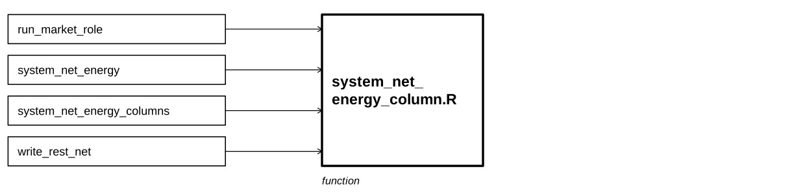

# system_net_energy_column.R

**Function** &nbsp;·&nbsp; `30_Simulation/03_Functions/system_net_energy_column.R`

## Function

Gives the name of the column that holds the net electricity of the system for one itinerary. It is used by the places of the economic side that need a column name instead of the values (for example the weights and the per-interval sums by name). The column is Elec_total_<itinerary>: in Main_df it holds the sum over the assets, and in the table of each asset, which holds a column of the same name, the electricity of that asset. The naming rule lives only here, and system_net_energy() builds on it.
<https://github.com/robgaray/Model-Predictive-Control-in-Buildings>

## Called by

- [run_market_role.R](run_market_role.md)
- [system_net_energy.R](system_net_energy.md)
- [system_net_energy_columns.R](system_net_energy_columns.md)
- [write_rest_net.R](write_rest_net.md)

## What it calls, in order of appearance

- Nothing: this piece calls no other piece of the project.

## Input data

- itinerary : Character scalar. One of "exec", "plan", "plan_flex_down" or "plan_flex_up".

## Output data

- Character scalar: the column name, for example "Elec_total_plan".

## Other notes from the file header

### Code outline

1. Check the itinerary
2. Build the column name

### Usage instructions

```r
system_net_energy_column("plan")
```

## Diagram



Also available as [system_net_energy_column.svg](system_net_energy_column.svg).

---

[Back to the code structure index](../Code_Structure.md)
