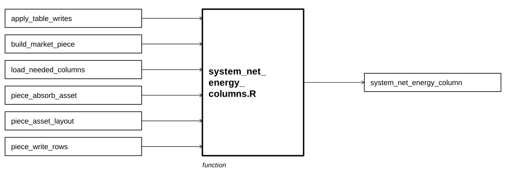

# system_net_energy_columns.R

**Function** &nbsp;·&nbsp; `30_Simulation/03_Functions/system_net_energy_columns.R`

## Function

Gives the names of the columns that hold the net electricity of the system, one per itinerary. These are the only columns that Main_df and the table of an asset hold both with a different meaning: in Main_df the column is the sum over the assets of the column of the same name in the table of each asset. Every place that has to decide whether a column is written again as that sum asks this function, so the decision lives only here.
<https://github.com/robgaray/Model-Predictive-Control-in-Buildings>

## Called by

- [apply_table_writes.R](apply_table_writes.md)
- [build_market_piece.R](build_market_piece.md)
- [load_needed_columns.R](load_needed_columns.md)
- [piece_absorb_asset.R](piece_absorb_asset.md)
- [piece_asset_layout.R](piece_asset_layout.md)
- [piece_write_rows.R](piece_write_rows.md)

## What it calls, in order of appearance

- [system_net_energy_column.R](system_net_energy_column.md)

## Input data

- None.

## Output data

- Character vector of four names: the column of the itineraries "exec", "plan", "plan_flex_down" and "plan_flex_up", in that order.

## Other notes from the file header

### Code outline

1. Name the column of each itinerary

### Usage instructions

```r
net_columns <- system_net_energy_columns()
```

## Diagram



Also available as [system_net_energy_columns.svg](system_net_energy_columns.svg).

---

[Back to the code structure index](../Code_Structure.md)
