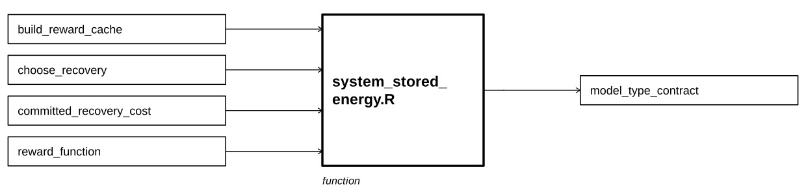

# system_stored_energy.R

**Function** &nbsp;·&nbsp; `30_Simulation/03_Functions/system_stored_energy.R`

## Function

Gives the change of the energy the assets of the system store on each row of a piece, in each of the three itineraries, on the side of the system (kWh). It is the one place where the system adds what the assets store: the reward values it as stored energy (compute_stored_energy_value()). Each asset gives its own change through the operation stored_energy_change of its type of model (model_type_contract()), on its table, and the system adds them in the order of the asset registry. An asset that stores no energy gives NULL and adds nothing.

## Called by

- [build_reward_cache.R](build_reward_cache.md)
- [choose_recovery.R](choose_recovery.md)
- [committed_recovery_cost.R](committed_recovery_cost.md)
- [reward_function.R](reward_function.md)

## What it calls, in order of appearance

- [model_type_contract.R](model_type_contract.md)

## Input data

- piece      : The piece of the planning period, with the table of each asset in piece$assets[[asset_id]]$df.
- parameters : Named list. parameters$assets, the asset registry, with the parameters of each asset.

## Output data

- NULL when no asset of the registry stores energy. Otherwise a named list with the numeric vectors plan, plan_flex_down and plan_flex_up, one value per row of the piece (kWh, positive when the assets store energy).

## Other notes from the file header

### Code outline

1. Add the change of each asset that stores energy

### Usage instructions

```r
stored_energy <- system_stored_energy(piece, parameters)
```

## Diagram



Also available as [system_stored_energy.svg](system_stored_energy.svg).

---

[Back to the code structure index](../Code_Structure.md)
