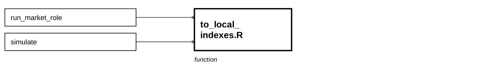

# to_local_indexes.R

**Function** &nbsp;·&nbsp; `30_Simulation/03_Functions/to_local_indexes.R`

## Function

Converts the global indexes of a period (rows of the full Main_df) into local indexes (rows of the piece of Main_df cut for that period). The local index of the first row of the period is 1, and every other index keeps its distance to that row.

## Called by

- [run_market_role.R](run_market_role.md)
- [simulate.R](simulate.md)

## What it calls, in order of appearance

- Nothing: this piece calls no other piece of the project.

## Input data

- indexes_global: list, simulation_control$indexes_global, with these elements already filled for the period:
    - i0
    - i_begin_horizon
    - i_end_horizon
    - i_end_control
    - idx_period
    - idx_horizon
    - idx_ctrl

## Output data

- Named list with the local version of the indexes:
    - i0
    - i_begin_horizon
    - i_end_horizon
    - i_end_control
    - idx_period
    - idx_horizon
    - idx_ctrl
    - i_flex

## Other notes from the file header

### Code outline

1. Set the local index of the first row of the period
2. Shift every global index by the first row of the period
3. Return the local indexes

### Usage instructions

```r
local_indexes <- to_local_indexes(
  indexes_global = simulation_control$indexes_global
  )
```

simulation_control$indexes_local[names(local_indexes)] <-

- local_indexes

## Diagram



Also available as [to_local_indexes.svg](to_local_indexes.svg).

---

[Back to the code structure index](../Code_Structure.md)
