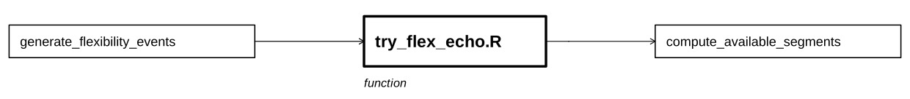

# try_flex_echo.R

**Function** &nbsp;·&nbsp; `30_Simulation/03_Functions/try_flex_echo.R`

## Function

Implements the Scheduling-only "echo" mechanism (advance/delay) of flexibility events: given a not-yet-displaced Scheduling event whose forbidden zone overlaps a new Scheduling market's horizon, independently rolls P_advance/P_delay (tie-broken by an extra random number if both roll), and - if a direction is chosen - shifts the event by a market_resolution-aligned Delta and checks whether the shifted event still fits entirely within the horizon, once the forbidden zone of every *other* Scheduling event is taken out of it. Does not resample the shifted position: either the single deterministic shift fits, or it does not (no second attempt within this call - a later market may offer the event another echo, until the first success).

## Called by

- [generate_flexibility_events.R](generate_flexibility_events.md)

## What it calls, in order of appearance

- [compute_available_segments.R](compute_available_segments.md)

## Input data

- event                  : List with t_start_sec, duration_sec (the event being offered an echo).
- horizon_begin, horizon_end : Numeric scalars (seconds). The current Scheduling market's Horizon(m).
- other_events           : List of lists, each with t_start_sec, duration_sec - every other currently active Scheduling event (i.e. E_sched minus `event` itself).
- P_advance, P_delay     : Numeric scalars in [0,1].
- Max_shift_hours        : Numeric scalar (hours).
- market_resolution_sec  : Numeric scalar (seconds).
- margin_sec             : Numeric scalar (seconds). Has no default: generate_flexibility_events() passes its own parameters$computing$flexibility_event_margin_sec. The exclusion margin used to build each event's forbidden zone.

## Output data

- List with:
    - accepted: logical
    - t_start_sec and duration_sec of the shifted event, when accepted is TRUE

## Other notes from the file header

### Usage instructions

```r
try_flex_echo(event, horizon_begin, horizon_end, other_events,
  P_advance, P_delay, Max_shift_hours, market_resolution_sec)
```

### Code outline

1. Roll for an advance and for a delay, and pick a direction between them when both come up.
2. Draw a shift in that direction, bounded by the maximum.
3. Return the shifted event only if it still fits the horizon and keeps its margin from every other event.

## Diagram



Also available as [try_flex_echo.svg](try_flex_echo.svg).

---

[Back to the code structure index](../Code_Structure.md)
